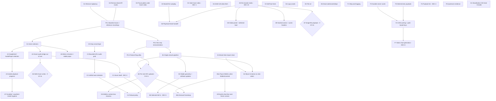

# KADENCE — Performance Recovery Roadmap

**Status:** Plan only. No application code has been changed.
**Input:** `KADENCE_MASTER_PERFORMANCE_AUDIT.md` (2026-11-01, commit `e5ab927`)
**Stack checked against installed versions:** Next.js 16.2.6 · React 19.2.4 · three 0.184.0 · @react-three/fiber 9.6.1 · zustand 5.0.13 · framer-motion 12
**Goal:** Make KADENCE responsive, reliable and production-grade while keeping its features, visual identity and interaction design exactly as they are.

---

## Contents

1. [Ground rules for the recovery project](#1-ground-rules-for-the-recovery-project)
2. [Audit corrections found while planning](#2-audit-corrections-found-while-planning)
3. [Confirmed issues vs. hypotheses](#3-confirmed-issues-vs-hypotheses)
4. [Decisions needed from product/design](#4-decisions-needed-from-productdesign)
5. [Dependency graph and critical path](#5-dependency-graph-and-critical-path)
6. [Phase plan at a glance](#6-phase-plan-at-a-glance)
7. [Task specifications](#7-task-specifications)
   - [Phase 0 — Baseline, guardrails, safe removals](#phase-0--baseline-guardrails-safe-removals)
   - [Workstream A — React rendering & Zustand subscriptions](#workstream-a--react-rendering--zustand-subscriptions)
   - [Workstream B — WebGL lifecycle & GPU textures](#workstream-b--webgl-lifecycle--gpu-textures)
   - [Workstream C — Audio lifecycle & media requests](#workstream-c--audio-lifecycle--media-requests)
   - [Workstream D — Video delivery, decoding & playback](#workstream-d--video-delivery-decoding--playback)
   - [Workstream E — Initial bundle & asset loading](#workstream-e--initial-bundle--asset-loading)
   - [Workstream F — API caching & backend efficiency](#workstream-f--api-caching--backend-efficiency)
   - [Workstream G — Security & reliability](#workstream-g--security--reliability)
   - [Workstream H — Compositing & animation cost (supporting)](#workstream-h--compositing--animation-cost-supporting)
8. [Verification protocol (applies to every PR)](#8-verification-protocol-applies-to-every-pr)
9. [Master task table](#9-master-task-table)
10. [Success metrics for the whole programme](#10-success-metrics-for-the-whole-programme)

---

## 1. Ground rules for the recovery project

1. **One task, one PR.** Every task below fits in a single reviewable PR, roughly ≤ 400 changed lines; most are much smaller. Each PR can be reverted on its own.
2. **No visual or behavioural change unless it is a listed, signed-off decision** (§4). "Preserve" means the same layouts, colours, typography, motion curves, audio behaviour and feature set. Any pixel or timing difference must be called out in the PR description.
3. **Measure before you optimise anything marked *Hypothesis*.** Tasks gated on a hypothesis (§3.2) do not start until the Phase 0 baseline shows the problem is real and material.
4. **Feature flags for risky changes.** Tasks marked **[flag]** ship behind a runtime flag (P0.3), so production can be rolled back without a revert.
5. **Required checks on every PR:** `tsc --noEmit` passes · no new ESLint errors · `next build` succeeds · bundle-size report attached · visual-parity evidence attached (§8).
6. **Ordering:** follow the priority you set (A → G). Where tasks don't depend on each other, the workstreams can run in parallel lanes (§5).
7. **Before any Next.js-specific change**, read the relevant guide in `node_modules/next/dist/docs/`, as `AGENTS.md` requires. The guides relevant to this plan are listed inside each task.

### Size legend

| Size | Meaning |
|---|---|
| **S** | Hours; under ~50 lines |
| **M** | 1–2 days |
| **L** | 3–5 days |
| **XL** | More than a week; split into sub-PRs |

### Profiling legend

| Label | Meaning |
|---|---|
| **Gating** | A browser trace must confirm the problem *before* work starts, and confirm the gain after. |
| **Confirm** | The defect is certain; capture before/after traces to *quantify* the gain. The task does not wait on profiling. |
| **None** | Deterministic; functional verification is enough. |

---

## 2. Audit corrections found while planning

Re-reading the code against concrete solutions surfaced three points where the audit was imprecise. They change task design, not priorities.

| # | Audit statement | Correction | Effect on this plan |
|---|---|---|---|
| AC-1 | `PreviewVideoLayer` is "a no-op; effectively dead". | It **does** render something: a `bg-black/30` tint while a tile is in preview mode (`PreviewVideoLayer.tsx:47-50`). Only its video logic is dead. | E6 removes the dead video code but **keeps the tint layer**. |
| AC-2 | Song fields `x/y/z/vx/vy/scale` are "unused by the wall". | `x` and `y` **are used**: `Universe.tsx:68` passes `selectedSong.x/y` to `CameraController` to pan the camera when Song Detail opens. `z/vx/vy/scale` have no consumer in the rendering path. | F4 keeps `x`/`y`. F5 makes them deterministic instead of `Math.random()`. |
| AC-3 | The intro cards' 14 `backdrop-filter`s and blend layers "must be recomputed every video frame". | Uncertain. Each card's opaque tile image sits directly under the blur layer, and the card's 3D transform creates its own stacking context, so blending happens against the static image. Whether Chromium still re-evaluates the backdrop when the video *underneath the card* changes depends on damage tracking. | Moved from "Probable" to **Hypothesis HY-4**. H4 is gated on profiling. |

---

## 3. Confirmed issues vs. hypotheses

### 3.1 Confirmed code issues (provable from source or build output; no profiling needed to justify the fix)

| ID | Issue | Evidence | Fixed by |
|---|---|---|---|
| CF-1 | `Home` subscribes to the whole `useUIStore`, `usePerformanceStore` and `useAudioStore` | `app/page.tsx:117-119` | A1 |
| CF-2 | `SongDetail` and `GlobalAudioPlayer` subscribe to the whole `useAudioStore` | `SongDetail.tsx:407`, `GlobalAudioPlayer.tsx:13-21` | A2 |
| CF-3 | Playback `progress` written to the global store every 125 ms | `GlobalAudioPlayer.tsx:8`, `:126-131` | A3 |
| CF-4 | Hover → audio bridge is a root-level selector plus effect | `page.tsx:292-304` | A4, C1 |
| CF-5 | Store writes from inside `useFrame` (`onHover`) | `NodeField.tsx:741-751` | A4 (removes root subscriber); A5 if still needed |
| CF-6 | `Universe` not memoised; inline `onFps`; new `targetNodePos` object each render | `page.tsx:353`, `Universe.tsx:68` | A6 |
| CF-7 | Hover-created `Audio` elements bypass the concurrency limiter and are never evicted within a chart | `GlobalAudioPlayer.tsx:208-234`, `:109-120` | C2, C3 |
| CF-8 | 20 tracks fully preloaded (`preload='auto'`) on Universe entry | `GlobalAudioPlayer.tsx:55`, `:85` | C4 |
| CF-9 | Two independent artwork loaders writing to one atlas | `atlasManager.ts:78-270`, `NodeField.tsx:300-356` | B1 |
| CF-10 | Full 4096² atlas re-upload on every flush; per-frame flushes while `size ≤ 16` | `NodeField.tsx:543-553`, `atlasManager.ts:180`, `:256-268` | B1, B2 |
| CF-11 | Geometry and `InstancedMesh` rebuilt on every `songs.length` change; old geometry never disposed | `NodeField.tsx:361-425`, `:795-801` | B3 |
| CF-12 | `frameloop="always"` with no visibility gating | `Universe.tsx:36` | B4a, B4b |
| CF-13 | Hover-video system reacts to `hoveredVibe` in every view, including Switch Chart | `HoverMediaBackground.tsx:38`, `ChangeVibeOverlay.tsx:200` | D1 |
| CF-14 | Globe video never pauses under the hover video | `HeroBackgroundVideo.tsx:16-35` | D2 |
| CF-15 | Unmuted `play()` triggered by hover; preview revealed before `play()` resolves | `HoverMediaBackground.tsx:203-216`, `:288`, `:303` | D3 |
| CF-16 | Full video download starts as soon as the preview plays | `HoverMediaBackground.tsx:209-212` | D4 |
| CF-17 | Handoff seeks to 3.0 s with no keyframe there (keyframes measured by ffprobe); handoff timed by buffer, not playhead; both videos unmuted during the crossfade | `HoverMediaBackground.tsx:114-158`; ffprobe | D5, D6 |
| CF-18 | Media bitrates 1.8–9.5 Mbps at 1080p–1440p; no posters; filenames not content-hashed but served `immutable` | ffprobe; `next.config.ts:16-28` | D5, D8, D9 |
| CF-19 | three.js core in the initial bundle through `atlasManager`/`vibeService` imports | Build chunk `02hvssugk.d_m.js` (101 KB gz) | E1 |
| CF-20 | `Universe` chunk and WebGL context created on the intro screen | `page.tsx:26-29`, `:344` | E2 |
| CF-21 | Render-blocking Google Fonts: 7 families, 91 `@font-face` rules, 2 families unused | `layout.tsx:25-28` | E3 |
| CF-22 | Oversized logos (783 KB, 230 KB, both preloaded) and 1024² tile art | `public/`; `index.html` preload links | E4, E5 |
| CF-23 | Dead code, assets and dependencies | §7 E6 | E6 |
| CF-24 | Upstream `fetch` with `cache: 'no-store'`; per-instance `Map` cache; no response caching headers | `musicProvider.ts:522`, `:542`; `api/songs/route.ts:6`, `:59` | F2, F3 |
| CF-25 | Production `console.log` in hot paths | `musicProvider.ts:185-305`; `api/songs/route.ts:25-58` | F1 |
| CF-26 | Non-deterministic payloads (`Math.random`) and over-fetch beyond 256 displayable tracks | `musicProvider.ts:315-351`; `NodeField.tsx:23` | F4, F5 |
| CF-27 | Open server-side proxy | `app/api/proxy/route.ts` | G1 |
| CF-28 | Unused, unauthenticated upstream-calling routes | `app/api/songs/top`, `app/api/chart-preview` | G2 |
| CF-29 | `GlassButton` injects a ~6 KB `<style>` per instance; unthrottled `getBoundingClientRect` on `mousemove` | `GlassButton.tsx:300`, `:281-291` | H1 |
| CF-30 | Song Detail drawer has a CSS `transition-all 700ms` on a framer-animated element | `SongDetail.tsx:489-493` | H2 (needs sign-off) |
| CF-31 | `LiquidScrubber` forces layout on every progress tick; `transition-all` on width | `SongDetail.tsx:176-181`, `:261-264` | A7 |
| CF-32 | Search merges cause a full wall rebuild; no request cancellation | `page.tsx:305-316`; `SearchPanel.tsx:37-50` | B3, F8 |
| CF-33 | Selected-tile highlight compares a song index with an instance index (correctness) | `NodeField.tsx:84`, `:786-792` | B6 (needs sign-off) |

### 3.2 Hypotheses requiring browser profiling

Each hypothesis has a defined experiment and a decision threshold. Run all experiments in the Phase 0 baseline (P0.1).

| ID | Hypothesis | Experiment | Decision threshold | Gates |
|---|---|---|---|---|
| HY-1 | Each 8 Hz `Home` re-render costs several ms of main-thread time | React Profiler, 10 s of playback, no input | Only sets *expected gain*. A-tasks proceed regardless (CF-1..3) | — |
| HY-2 | Full atlas uploads stall the GPU or main thread materially | Performance panel with GPU track while entering a chart; dev counter of uploads (P0.2) | If p95 upload task ≥ 8 ms **or** ≥ 3 frames dropped per upload → do B2. Otherwise B1 + flush throttling is enough | B2 |
| HY-3 | `backdrop-filter`s over the live canvas (Navbar/Search `GlassButton`s, tooltip) cost significant GPU time | Toggle the effects off with DevTools overrides; compare GPU frame time | ≥ 2 ms GPU per frame on the reference laptop → propose H-tasks to design | H1b, H6 |
| HY-4 | Intro card backdrop and blend layers are re-evaluated per video frame (AC-3) | Rendering panel → Layer borders and paint flashing; GPU time with card overlays disabled | ≥ 2 ms GPU per frame or visible jank while scrolling the intro | H4 |
| HY-5 | Song Detail SVG turbulence/displacement filter is CPU-rasterised and expensive | Trace drawer open/close and idle-open; raster thread time | ≥ 4 ms raster per frame during the drawer animation | H3 |
| HY-6 | Three concurrent 1080p decodes (globe + preview + full) drop frames on mid-range devices | `chrome://media-internals` dropped frames; GPU-process CPU | Informs D5 encode targets. D2 proceeds regardless | D5 targets |
| HY-7 | Unmuted hover autoplay is rejected for first-time visitors (frozen first frame) | Fresh Chrome/Edge/Safari profiles; hover before any click | Any rejection observed → D3 is required (it is low-risk anyway) | D3 priority |
| HY-8 | The audio preload queue can deadlock after a hover sweep | Sweep 50+ tiles, then check whether preload continues (P0.2 counters) | Any stuck `'loading'` entries beyond 10 s | C3 scope |
| HY-9 | iTunes latency and rate limits cause slow first loads and 5xx in production | Vercel function logs: duration p50/p95, upstream status codes | p95 cold > 1.5 s or any 403/429 → raise F6/F7 priority | F6, F7 |
| HY-10 | Fragment shader at DPR 1.5 is GPU-bound on integrated GPUs | Compare GPU frame time at DPR 1.0 vs 1.5 | ≥ 25% GPU time difference → consider B8 | B8 |
| HY-11 | Synchronous hover renders inside `useFrame` cause long frames *after* A1–A4 | Trace a wall sweep after Phase 1 | Any hover-attributable task > 4 ms remaining | A5 |
| HY-12 | Jelly simulation costs measurable main-thread time | Self-time of `JellyField.update` in a trace | > 0.5 ms per frame | B7 |
| HY-13 | `CinematicBackground` full-screen blur costs significant paint/GPU time on song switch | Trace opening and switching songs | ≥ 4 ms per frame during the 1.2 s transition | H6 |
| HY-14 | Animated `box-shadow` (loader ring, card hover) causes paint-heavy frames | Paint profiler on the loader and on card hover | ≥ 3 ms paint per frame | H5 |
| HY-15 | One-file playback (no separate preview) reaches first frame as fast as the 3 s preview | Measure time-to-first-frame with the throttled "Fast 4G" preset for both designs | Within 150 ms of the preview → choose D7 over D6 | D6/D7 |

---

## 4. Decisions needed from product/design

These items are behaviour or perception changes, however small. Nothing in this list is implemented without explicit sign-off.

| ID | Question | Recommendation | Blocks |
|---|---|---|---|
| DEC-1 | Is the hover video **behind the Switch Chart overlay** (inside the Universe) intended? Today it plays unmuted on top of the iTunes preview audio. | Intended → keep it, but duck or pause wall audio while it plays and pause WebGL. Not intended → limit hover video to the intro. | D1 |
| DEC-2 | Is a short **hover dwell before wall audio** acceptable (tooltip stays instant)? | 120 ms, configurable. It removes the download storm when sweeping across tiles. | C1 |
| DEC-3 | The **Song Detail drawer** currently gets extra 700 ms overshoot from a CSS transition layered on the spring. Keep that feel (re-created in the spring parameters) or use the pure spring? | Re-create the current feel with spring parameters, signed off from a side-by-side recording. | H2 |
| DEC-4 | The Navbar shows `"{N} songs"`, where N can exceed the 256 tracks the wall can display. After payload trimming, should it show the full upstream total or the number displayed? | Keep today's number by sending a `total` field. | F4 |
| DEC-5 | Fix the selected-tile highlight (CF-33)? It is a visual change: the highlight moves to the clicked tile. | Yes; highlight the tile the user clicked. | B6 |
| DEC-6 | Media hosting: keep `public/` on Vercel, or move to object storage/CDN (Vercel Blob, Cloudflare R2/Stream, Mux)? | Object storage plus CDN now. Adaptive streaming only if hover video stays core on mobile. | D10 |
| DEC-7 | Telemetry and error reporting vendor (Vercel Analytics/Speed Insights, Sentry, self-hosted)? | Vercel Speed Insights + Sentry (free tiers). | G6 |
| DEC-8 | How fresh must chart data be? This determines static generation (cron) vs. live upstream. | Regenerate every 6–24 h with a cron job; serve static JSON. | F7 |
| DEC-9 | New dev dependencies for tests and CI (Playwright, Vitest, size-limit, bundle analyzer)? | Approve as dev-only. | G7 |
| DEC-10 | Media re-encode quality bar: may bitrate drop as long as an objective metric (VMAF ≥ 93) and a designer review pass? | Yes, judged under the existing `bg-black/60` dim, as shipped. | D5 |

---

## 5. Dependency graph and critical path

### Critical path (longest dependency chain to the core outcome)

**P0.1 → A1 → A2 → A3 → A7** gives responsive React rendering.
In parallel: **P0.2 → B1 → (B2 if HY-2) → B4b** gives a smooth wall.

Everything else hangs off these two chains or runs in parallel.

### Parallel lanes (who can work on what at the same time)

| Lane | Tasks | Notes |
|---|---|---|
| **Lane 1 — React** | A1 → A2 → A6 → A3 → A4 → A7 → (A5) | Core. Do first. |
| **Lane 2 — WebGL** | B4a → B1 → B3 → (B2) → B4b → B6 | B4a has no dependencies; ship it early. |
| **Lane 3 — Audio** | C5 → C2 → C3 → C1 → C4 | C1 waits for A4. |
| **Lane 4 — Video and assets** | D2, D3, D4 → D5 (asset work, offline) → D6/D7 → D8 → D9 | D5 is encoding work and can start on day 1. |
| **Lane 5 — Load** | E1 → E2, E3, E4, E5, E6 | Independent of React work, except E2 (needs B1). |
| **Lane 6 — Backend** | F1, F3, F5 → F2 → F4 → F6 → F7 | Fully independent of frontend lanes. |
| **Lane 7 — Security/reliability** | G1, G2 (immediately), G3, G4, G5 (after B2), G6–G8 | G1/G2 are zero-risk; land them first. |

---

## 6. Phase plan at a glance

Each phase is a set of small PRs that can be reviewed independently. A phase is "done" when its exit criteria are met. Phases 1–6 match your priority order; their lanes can overlap as §5 allows.

| Phase | Theme | Tasks | Exit criteria |
|---|---|---|---|
| **0** | Baseline, guardrails, safe removals | P0.1, P0.2, P0.3, G1, G2 | Baseline traces and recordings stored; counters available in dev; flags work; open proxy gone |
| **1** | React rendering & Zustand | A1, A2, A6, A3, A4, A7, (A5) | `Home` commits during passive playback = 0; per-tile `Home` commits = 0 |
| **2** | WebGL lifecycle & textures | B4a, B1, B3, (B2), B4b, B6, (B7, B8) | Image requests per chart entry ≤ 256; full atlas uploads per entry ≤ 2 (with B2) or ≤ 8 (B1 only); 0 rendered frames while Song Detail is open |
| **3** | Audio lifecycle | C5, C2, C3, C1, C4 | ≤ 12 live audio elements after any sweep; audio bytes in the first 30 s of the Universe ≤ 5 MB |
| **4** | Video delivery & playback | D2, D3, D1, D4, D5, D6 or D7, D8, D9 | One active decoder during hover; no frozen frames in fresh profiles; ≥ 50% fewer media bytes; seamless handoff |
| **5** | Initial bundle & assets | E1, E2, E3, E4, E5, E6, E8, E9 | Initial JS ≤ 235 KB gz; no third-party font requests; ≥ 1.5 MB fewer image bytes |
| **6** | API caching & backend | F1, F3, F5, F2, F4, F6, F8, (F7) | Cached chart TTFB p95 < 150 ms; 0 upstream calls on warm paths; no 5xx from upstream failure |
| **7** | Security & reliability | G3, G4, G5, G6, G7, G8, D10 | CSP enforced; context-loss recovery; RUM and error reporting live; CI budgets enforced |
| **8** | Compositing (profiling-gated, sign-off) | H1, H8, H9, H2, then H3–H7 if their hypotheses are confirmed | Only items whose hypotheses were confirmed and whose visuals were signed off |

> H1 (GlassButton CSS hoisting) and H8 (MagneticChromeText throttle) are confirmed issues with no visual change. They can land in Phase 1 if convenient.

---

## 7. Task specifications

Each task uses the same template:

- **Files** — exact files and components
- **Root cause**
- **Solution** — proposed technical approach
- **Depends on**
- **Impact** — expected performance effect
- **Risks** — regression risks and their mitigations
- **Verify** — verification criteria
- **Profiling** — Gating / Confirm / None

`[flag]` means the task ships behind a feature flag.

---

### Phase 0 — Baseline, guardrails, safe removals

#### P0.1 — Baseline traces and visual reference capture · S–M
- **Files:** none (process). Store the results under `docs/perf-baseline/`, or attach them to the tracking issue.
- **Root cause:** Without a baseline no gain can be proven, and the 15 hypotheses in §3.2 cannot be settled.
- **Solution:** Capture traces on two reference devices: (1) a mid-range laptop with integrated GPU, Chrome stable, plus a 4× CPU-throttle run; (2) a mid-range Android phone over USB debugging. Record six scenarios:
  - **S1** Cold load to idle intro (Lighthouse plus Performance trace).
  - **S2** Hover across five intro tiles, about 2 s each.
  - **S3** Click a chart until the wall is interactive.
  - **S4** 60 s of wall interaction with audio, including a fast sweep across about 50 tiles.
  - **S5** Open Song Detail, scrub, close.
  - **S6** Open Switch Chart, hover three charts, switch.

  For each scenario capture: Performance trace (with screenshots and the GPU track), Network HAR, Memory snapshot (S4), the React Profiler (S4, S5) and `chrome://media-internals` (S2). Also record reference **screen recordings and screenshots** of every view at 1920×1080, 1366×768 and 390×844 for visual parity.
- **Depends on:** —
- **Impact:** Enables every later decision.
- **Risks:** None.
- **Verify:** All six scenarios captured on both devices; HY-1..HY-15 each have recorded results.
- **Profiling:** This task *is* the profiling.

#### P0.2 — Dev-only performance instrumentation · S–M · [flag]
- **Files:** new `lib/perf/devCounters.ts`; small hooks in `GlobalAudioPlayer.tsx`, `lib/atlasManager.ts`, `NodeField.tsx`, `page.tsx`.
- **Root cause:** The key quantities — live audio elements, atlas uploads, R3F frames rendered, root commits — are invisible today.
- **Solution:** A tiny counter registry exposed on `window.__kadencePerf`, compiled in only when `process.env.NODE_ENV !== 'production'` or the `perfHud` flag is on. Counters: `audio.liveElements`, `audio.loadingCount`, `atlas.fullUploads`, `atlas.subUploads`, `atlas.imageRequests`, `r3f.framesRendered`, `react.homeCommits` (via `React.Profiler` `onRender`). An optional overlay HUD toggled with a key combination.
- **Depends on:** —
- **Impact:** None by itself; makes the verification criteria for B, C and A measurable.
- **Risks:** Instrumentation leaking into production. Mitigate with a build-time guard and a check that the counter strings are absent from the production bundle.
- **Verify:** Counters update in dev; the production bundle contains no `__kadencePerf`.
- **Profiling:** None.

#### P0.3 — Feature-flag utility · S
- **Files:** new `lib/flags.ts`.
- **Root cause:** Several tasks (B2, B4b, D6/D7, E2) carry rollout risk.
- **Solution:** Read `NEXT_PUBLIC_KADENCE_FLAGS` (a comma-separated list) with a `?flags=` URL override in non-production. Typed flag names. Default: all new paths off until verified.
- **Depends on:** —
- **Impact:** Rollback without a revert.
- **Risks:** Flags left on forever. Every flag has a removal task once the feature is stable (§9 notes).
- **Verify:** A flag toggles the code path in dev and in a preview deployment.
- **Profiling:** None.

#### G1 — Remove the open proxy route · S
- **Files:** `app/api/proxy/route.ts` (delete).
- **Root cause:** The route fetches any `?url=` server-side and returns it with `Access-Control-Allow-Origin: *` and a one-year immutable cache header. That is an SSRF and bandwidth-abuse vector. No client code calls it (grep-verified).
- **Solution:** Delete the route.
- **Depends on:** —
- **Impact:** Security. Removes an unbounded cost vector.
- **Risks:** None found in this repo. Check deployment logs for any external callers first.
- **Verify:** `GET /api/proxy?url=…` returns 404 on a preview deployment; the build succeeds.
- **Profiling:** None.

#### G2 — Remove unused upstream-calling routes and their store · S
- **Files:** `app/api/songs/top/route.ts`, `app/api/chart-preview/route.ts`, `store/chartPreviewStore.ts`; `lib/musicProvider.ts` (`fetchChartPreviews`, `fetchTopSongByVibe`, if they become unused).
- **Root cause:** Public, unauthenticated endpoints that spend iTunes quota and are referenced nowhere.
- **Solution:** Delete them, after confirming in logs that nothing external calls them.
- **Depends on:** —
- **Impact:** Smaller attack surface; protects upstream quota.
- **Risks:** Hidden external consumers. Mitigate with the log check.
- **Verify:** Build passes; grep shows no references; both routes return 404.
- **Profiling:** None.

---

### Workstream A — React rendering & Zustand subscriptions

#### A1 — Selector-only subscriptions in `Home` · S
- **Files:** `app/page.tsx` (`Home`, lines 117–119, 353).
- **Root cause:** `useUIStore()`, `usePerformanceStore()` and `useAudioStore()` without selectors subscribe `Home` to every field: `progress` at 8 Hz and `hoveredVibe` on every intro hover. `Home` is the root of every view (CF-1).
- **Solution:**
  - `const isSearchOpen = useUIStore(s => s.isSearchOpen)` and `const setSearchOpen = useUIStore(s => s.setSearchOpen)`. Store actions are stable references in zustand 5, so these subscriptions never re-render.
  - `const playUrl = useAudioStore(s => s.playUrl)`.
  - Remove the `usePerformanceStore` subscription. `onFps` is never invoked by `Universe`; keep the prop wiring until E6 removes it.
  - No other logic changes.
- **Depends on:** P0.1 (to capture "before").
- **Impact:** Removes about 8 `Home` commits per second during playback, and one `Home` commit per intro hover. Likely the largest single main-thread gain.
- **Risks:** Very low. Selectors return stable action references.
- **Verify:**
  - React Profiler, 10 s passive playback: `Home` commits drop from ~80 to **0**.
  - Intro hover: `Home` does not commit.
  - All views behave the same (functional checklist §8).
- **Profiling:** Confirm.

#### A2 — Selector-only subscriptions in `SongDetail` and `GlobalAudioPlayer` · S
- **Files:** `components/ui/SongDetail.tsx:407`; `components/GlobalAudioPlayer.tsx:13-21`.
- **Root cause:** Whole-store destructuring (CF-2). `GlobalAudioPlayer` does not need `progress` at all, yet re-renders at 8 Hz.
- **Solution:**
  - `GlobalAudioPlayer`: select only `currentUrl`, `isPlaying`, `seekRequest` and `preloadedUrls` (`useShallow` from `zustand/react/shallow`, or one selector each). Read actions through `useAudioStore.getState()` inside effects.
  - `SongDetail`: select `isPlaying`, `togglePlay` and `seekTo` only. `progress` and `duration` move into leaf components in A3.
- **Depends on:** A1 (same pattern; review together).
- **Impact:** Removes 8 Hz renders of the 800-line `SongDetail` tree (always mounted) and of `GlobalAudioPlayer`.
- **Risks:** Low. The effect dependency arrays in `GlobalAudioPlayer` must still fire on the same transitions. Fix the `processQueue` use-before-declare (lint `react-hooks/immutability`, `:61`) by turning it into a ref-held function.
- **Verify:**
  - Profiler: `GlobalAudioPlayer` and `SongDetail` commit only on play/pause, track change and seek.
  - Audio start, stop, fade, seek and auto-end behave exactly as before.
- **Profiling:** Confirm.

#### A3 — Isolate playback progress into leaf subscribers · M
- **Files:** `store/audioStore.ts`; `components/GlobalAudioPlayer.tsx` (progress timer `:124-139`); `components/ui/SongDetail.tsx` (`LiquidScrubber`, waveform block `:651-665`, time display).
- **Root cause:** `progress` is global render state written at 8 Hz (CF-3). Even with selectors, any consumer re-renders on every tick.
- **Solution:**
  - Keep `progress` and `duration` in the store (the public API is unchanged) and subscribe **only** in three new leaf components inside `SongDetail`: `<WaveformBars>`, `<ScrubberFill>` and `<TimeLabel>`.
  - `<WaveformBars>` subscribes to a **derived integer**: `Math.floor(progress / 100 * 40)`, the number of lit bars. It re-renders only when a bar boundary is crossed, about 1.3 times per second instead of 8.
  - `<TimeLabel>` subscribes to `Math.floor(progress / 100 * duration)` and re-renders once per second.
  - Alternative, if P0.1 shows the ticks still matter: drive the scrubber fill through a ref and `useAudioStore.subscribe` (no React render).
  - Keep the 125 ms timer cadence so the visual result is identical.
- **Depends on:** A2.
- **Impact:** Song Detail open: commits per second fall from ~8 full-panel renders to ~1–2 tiny leaf renders.
- **Risks:**
  - Scrubber spring alignment (`targetX.set` in an effect keyed on progress) must move into `<ScrubberFill>` unchanged.
  - The time label must not drift — verify against `audio.currentTime`.
  - The bar glow `boxShadow` logic must stay identical.
- **Verify:**
  - Side-by-side recording shows identical waveform lighting, scrubber motion and time labels.
  - Profiler: `SongDetail` root commits = 0 during playback.
- **Profiling:** Confirm.

#### A4 — Move the hover → audio bridge out of the React root · S–M
- **Files:** `app/page.tsx:292-304`; `components/GlobalAudioPlayer.tsx` (new effect), or new `lib/audio/audioDirector.ts`.
- **Root cause:** `targetAudioUrl` is a selector on `Home` over `hoveredSong`/`selectedSong`/`isChangingVibe`. Every tile crossing re-renders the root synchronously — and inside the R3F frame, because `hoverSong` is called from `useFrame` (CF-4, CF-5).
- **Solution:**
  - Replace the selector and effect with a non-rendering subscription, created once in `GlobalAudioPlayer`'s mount effect: `useSongStore.subscribe((state, prev) => { … })`.
  - It computes exactly the same value — `isChangingVibe ? null : hoveredSong?.previewUrl ?? selectedSong?.previewUrl ?? null` — and calls `playUrl` only when that value changes **and is non-null**. This preserves today's semantics: a null target never stops audio.
  - zustand 5's vanilla `subscribe(listener)` receives `(state, prevState)`, so no middleware is needed.
- **Depends on:** A1.
- **Impact:** Removes one synchronous full-tree render per tile crossed. Only `HoverTooltip` (memoised) and the subscriber run.
- **Risks:**
  - Subtle ordering against `handleSelectSong`, which also calls `playUrl`. Today both paths may call it in one interaction, and the store dedupes because `currentUrl` doesn't change. Keep that idempotence and add a guard against redundant `playUrl` with the same URL.
  - Unsubscribe on unmount.
- **Verify:**
  - Hover a tile: audio switches as before.
  - Close Song Detail while hovering nothing: audio behaviour unchanged.
  - Profiler: `Home` commits per tile crossing = 0.
- **Profiling:** Confirm.

#### A5 — (Conditional) Defer hover store writes out of the frame loop · S
- **Files:** `components/universe/NodeField.tsx:741-751`.
- **Root cause:** Hypothesis HY-11 — after A1–A4, the remaining synchronous subscribers (`HoverTooltip`, the audio subscriber) still lengthen frames during sweeps.
- **Solution:** Keep hover detection in `useFrame` (it must stay frame-accurate), but publish the change with a coalesced `queueMicrotask` or post-frame callback. Only the latest hover per frame is published. The cursor style update stays immediate.
- **Depends on:** A4 and the HY-11 result.
- **Impact:** Shorter frames during fast sweeps; tooltip latency unchanged (≤ 1 frame).
- **Risks:** Tooltip one frame late (imperceptible).
- **Verify:** No hover-attributable task > 4 ms in the S4 trace.
- **Profiling:** Gating (HY-11).

#### A6 — Memoise `Universe` and stabilise its props · S
- **Files:** `components/universe/Universe.tsx`; `app/page.tsx:344-354`.
- **Root cause:** The inline `onFps` arrow and a `targetNodePos` object rebuilt each render defeat memoisation. `CameraController`'s effect re-runs on every render while a song is selected (CF-6).
- **Solution:**
  - `export const Universe = memo(function Universe(...))`.
  - In `Home`, hoist `onFps` into a `useCallback`, or drop it (unused; removed in E6).
  - Inside `Universe`, `useMemo` `targetNodePos` on `selectedSong?.id`, `x` and `y`.
- **Depends on:** A1.
- **Impact:** The R3F subtree stops re-rendering on unrelated `Home` renders (search open, preview tint, …).
- **Risks:** Low. Make sure every callback passed to `Universe` is stable — `hoverSong` (store action), `handleSelectSong` (`useCallback`) and `setPreviewSong` (state setter) already are.
- **Verify:** Profiler: `Universe` commits only when `songs`, `selectedSong`, `currentVibe`, `isRefreshing` or `isDetailOpen` change.
- **Profiling:** Confirm.

#### A7 — Scrubber layout hygiene · S
- **Files:** `components/ui/SongDetail.tsx` (`LiquidScrubber` `:176-181`, `:261-264`).
- **Root cause:** `getBoundingClientRect()` runs in an effect on every progress tick, forcing layout right after commit. `transition-all` on a width that changes every 125 ms keeps layout running (CF-31).
- **Solution:**
  - Cache the track width in a ref, updated by a `ResizeObserver` and on `pointerdown`. Remove the per-tick `getBoundingClientRect`.
  - Narrow `transition-all` to `transition-[width]` with the same duration and easing. That is visually identical and prevents unrelated properties from transitioning.
  - Add `contain: layout paint` on the 8 px track, so layout from width changes stays inside it.
  - Do **not** switch to a `scaleX` transform: the fill has `rounded-full` ends that would distort.
- **Depends on:** A3.
- **Impact:** Removes 8 forced layouts per second while Song Detail is open.
- **Risks:** Rect stale after the drawer animates in. The `ResizeObserver` plus refresh on `pointerdown` cover it.
- **Verify:** Trace: no "Forced reflow" warnings attributed to `LiquidScrubber`; identical scrubbing behaviour.
- **Profiling:** Confirm.

---

### Workstream B — WebGL lifecycle & GPU textures

#### B4a — Pause the render loop when the wall is hidden or covered · S · [flag]
- **Files:** `components/universe/Universe.tsx:36`; `app/page.tsx` (passes `isDetailOpen`, plus a new `isOverlayOpen` from `isChangingVibe`).
- **Root cause:** `frameloop="always"` renders 60 fps while the canvas is at `opacity: 0` under Song Detail, and under the full-screen 64 px backdrop blur of Switch Chart (CF-12). Every backdrop-filter above it is then recomputed every frame.
- **Solution:**
  - Compute `frameloop = paused ? 'never' : (songs.length ? 'always' : 'demand')`.
  - `paused` becomes true when (a) Song Detail has been open for ≥ 650 ms — after the 600 ms opacity/blur transition, so the camera move and fade-out still render — or (b) the Switch Chart overlay is fully open (after its 400 ms fade-in).
  - On close, un-pause **immediately**, before the fade-in starts.
  - The last presented frame stays on screen when rendering stops, so the frozen wall under the Switch Chart blur looks the same.
- **Depends on:** — (P0.3 for the flag).
- **Impact:** GPU work drops to about zero in Song Detail and Switch Chart. Backdrop blurs above a static canvas become cheap, which also resolves H9.
- **Risks:**
  - Camera or jelly state frozen mid-motion. The pause starts only after transitions finish, and physics resumes from refs.
  - Switching charts *from* the overlay: un-pause on selection, before `setSongs`.
  - Atlas uploads queued while paused are applied on resume.
- **Verify:**
  - `r3f.framesRendered` stays flat while Song Detail is open.
  - The trace shows an idle GPU.
  - Recordings of open and close transitions are identical.
- **Profiling:** Confirm.

#### B1 — Single artwork pipeline owned by `atlasManager` · M
- **Files:** `lib/atlasManager.ts`; `components/universe/NodeField.tsx` (delete the loader `:300-356` and the flush logic `:543-553`); `app/page.tsx` (`handleVibeSelect`, `handleChangeVibe`, `handleRefresh`, `handleSearchResults`).
- **Root cause:** Two independent loaders download, decode and draw the same 256 artworks into one canvas. Each has its own flush policy, which triggers 25–40 full 64 MB uploads (CF-9, CF-10).
- **Solution:**
  - Remove the `NodeField` loader. Add one idempotent method, `atlasManager.sync(songs)`. It keeps a `slot → artworkUrl` map, loads only slots whose URL changed, and keeps the critical/background tiers that exist today.
  - **Important:** `handleSearchResults` currently relies on the `NodeField` loader to fetch art for appended songs, so it must call `atlasManager.sync(merged)`. Otherwise search-added tiles stay blank.
  - One flush policy only: flush at the end of the critical tier, then at most every 500 ms while background loading continues, plus a final flush. Use `atlasManager`'s `AbortController` for chart switches.
- **Depends on:** P0.2 (counters).
- **Impact:** Image requests and decodes per chart entry fall from ~512 to ≤ 256. Full uploads fall from ~25–40 to ~6–10 per entry.
- **Risks:**
  - Blank tiles after a search merge — the `sync()` call above covers it.
  - Tiles flashing dark on chart switch (today the canvas is cleared before the new art arrives). Keep current behaviour unless signed off.
  - Abort and race between `prepareCriticalVibe` and a running background load (already partly handled by `abortController`).
- **Verify:**
  - `atlas.imageRequests` ≤ 256 per chart entry and ≤ (new songs) per search merge.
  - `atlas.fullUploads` ≤ 10 per entry.
  - Every scenario (entry, switch, refresh, search) fills all visible tiles, identically to the reference recordings.
- **Profiling:** Confirm.

#### B3 — Stable instanced geometry; update attributes in place · M
- **Files:** `components/universe/NodeField.tsx` (`texIndices` `:361-408`, `geometry` `:420-425`, mesh `:795-801`, reset effect `:305-309`).
- **Root cause:** `texIndices` depends on `songs.length`, so any change (search merge, chart switch) creates a new `geometry`. That changes R3F `args`, which reconstructs the `InstancedMesh`. The old geometry is never disposed (CF-11, CF-32).
- **Solution:**
  - Create the geometry and its `InstancedBufferAttribute`s once per `count`, which depends only on the viewport.
  - When `songs.length` changes, recompute the shuffle into the existing `aTexIndex` array (`attr.array.set(newIndices); attr.needsUpdate = true`), using the **same** deterministic xorshift and neighbour-swap algorithm so layouts stay identical.
  - Dispose the geometry and material on unmount, and when `count` changes.
- **Depends on:** B1 (the reset semantics change there).
- **Impact:** Search, refresh and chart switch no longer rebuild the mesh. Fixes a small GPU buffer leak.
- **Risks:**
  - Tile layout drift if the shuffle inputs change. Unit-test that the old and new code produce identical `texIndices` for the same `(count, songs.length)`.
  - Hover mapping depends on `texIndices`; keep it in a ref that is updated together with the attribute.
- **Verify:**
  - Identical wall layout (screenshot diff) for each chart.
  - No `InstancedMesh` reconstruction on search (R3F devtools, or a counter).
  - `renderer.info.memory.geometries` stays flat across 10 searches.
- **Profiling:** None.

#### B2 — Per-slot GPU uploads instead of full-atlas re-uploads · L · [flag] · *gated on HY-2*
- **Files:** `lib/atlasManager.ts`; `components/universe/NodeField.tsx` (upload drain in `useFrame`); shader UV mapping unchanged (`NodeField.tsx:191-202`).
- **Root cause:** `CanvasTexture.needsUpdate` re-uploads all 64 MB (4096² RGBA) for every flush, even when only one 256² tile changed (CF-10).
- **Solution:**
  - Allocate the atlas once as a GPU texture (a 4096² `Texture` or `DataTexture`, initialised with `renderer.initTexture`).
  - Decode each artwork with `createImageBitmap(blob, { resizeWidth: 256, resizeHeight: 256, imageOrientation: 'flipY' })` — off the main thread, at exact size.
  - Wrap each bitmap in a small source `Texture` and copy it into its slot with `renderer.copyTextureToTexture(src, atlas, null, new THREE.Vector2(x, y))`. three r184 signature: `(srcTexture, dstTexture, srcRegion, dstPosition, srcLevel, dstLevel)`.
  - Drain at most N copies per frame (start with 8).
  - Fallback slots (`drawFallbackSlot`) become tiny solid-colour textures copied the same way.
  - Remove the 64 MB 2D canvas.
- **Depends on:** B1; P0.3; the HY-2 result. If HY-2 fails its threshold, ship B1 only and close B2.
- **Impact:** Upload traffic falls from ~1.6–2.6 GB to ~16 MB per chart entry. Removes the remaining post-entry hitching. Saves ~64 MB of RAM (the canvas backing store).
- **Risks:**
  - **Orientation and row mapping:** today's layout relies on `CanvasTexture` `flipY` plus the shader's `cols - 1 - row`. Validate with a debug render of slot numbers, and keep the colour space (`NoColorSpace`), filters (`Linear`) and the no-mipmaps setting.
  - **WebGL context loss:** a GPU-only atlas loses its content on context loss. This *requires* G5 (keep a URL list and re-sync on `webglcontextrestored`).
  - **Safari:** `createImageBitmap` resize options have partial support. Fall back to a canvas-resize path.
  - **Abort:** in-flight bitmaps for the old chart must be dropped by slot generation.
- **Verify:**
  - `atlas.fullUploads` = 0 after initial allocation; `atlas.subUploads` = number of slots loaded.
  - S3/S4 traces show no upload-attributable long frames.
  - Pixel-level screenshot diff of the full wall ≈ 0.
  - Context-loss test (`WEBGL_lose_context`) restores all tiles.
- **Profiling:** Gating (HY-2).

#### B4b — Demand-driven frame loop while the wall is idle · M · [flag]
- **Files:** `components/universe/Universe.tsx`; `components/universe/NodeField.tsx`; `components/universe/CameraController.tsx`; `lib/jellyField.ts` (expose an `isSettled()` method).
- **Root cause:** The wall renders 60 fps even when nothing moves (cursor still, jelly settled, camera converged, no pop animation, no pending uploads).
- **Solution:**
  - Switch to `frameloop="demand"`.
  - Call `invalidate()` on `pointermove`/`pointerleave`, and continue it while any of these hold: the jelly field is not settled, the camera is more than ε from target, `popProgress` is between 0 and 1, a hover dwell timer is running (the 1 s pop), or atlas uploads are pending.
  - `NodeField`'s `useFrame` calls `invalidate()` at its end while any of these conditions holds.
- **Depends on:** B4a; B2 (the upload queue must invalidate), or B1 if B2 is skipped.
- **Impact:** Near-zero GPU and CPU when the user is reading the tooltip or listening without moving. Large battery savings on laptops.
- **Risks:**
  - Missed frames: the 1 s dwell → pop trigger depends on elapsed time, so keep invalidating while hovered.
  - Spring cursor smoothing: invalidate until it converges.
  - `uTime` is declared but unused in the shaders, so no time-based motion is lost.
- **Verify:**
  - With the cursor still for 5 s, `r3f.framesRendered` stops growing within ~1 s.
  - All motion — jelly wake, pop, lens, camera — is identical in recordings.
- **Profiling:** Confirm.

#### B5 — Canvas-wrapper blur during refresh · S · *gated on HY-3*
- **Files:** `app/page.tsx:336-343`.
- **Root cause:** An animated `filter: blur()` over a live canvas forces a full-screen blur every frame. B4a already removes the Song Detail case, because the canvas is frozen once it is invisible. What remains is the refresh state (`blur(12px) brightness(0.8)` over a canvas that is still loading art).
- **Solution:** If HY-3 confirms the cost, pause rendering during refresh too: the wall is blurred and updating behind a fixed overlay anyway. Flush uploads when refresh ends. Do not change the visual blur.
- **Depends on:** B4a.
- **Impact:** Smoother refresh.
- **Risks:** Tiles fill-in appears all at once instead of progressively during refresh (a minor perception change). Show the recording to design.
- **Verify:** Refresh recording side-by-side; GPU time during refresh.
- **Profiling:** Gating.

#### B6 — Fix the selected-tile highlight index (correctness) · S · *needs DEC-5*
- **Files:** `components/universe/NodeField.tsx:84`, `:786-792`, click handler `:504-521`.
- **Root cause:** `uSelectedIdx` holds a song index, but the shader compares it with the instance index (CF-33).
- **Solution:** Store the clicked instance index (`lastHoverVisualIdx.current`) at click time and pass that as `uSelectedIdx`. Clear it when the selection clears.
- **Depends on:** B3; DEC-5.
- **Impact:** Correctness only.
- **Risks:** A visual change (it is the fix). Make sure search-selected songs, which have no clicked tile, keep the current fallback.
- **Verify:** Clicking a tile highlights that tile; recording reviewed by design.
- **Profiling:** None.

#### B7 — Skip jelly integration when settled · S · *gated on HY-12*
- **Files:** `lib/jellyField.ts:104-290`; `NodeField.tsx:634-640`.
- **Root cause:** 2,304 cells are integrated every frame even at rest.
- **Solution:** Track `isSettled` (the existing activity scan) and skip `update()` while settled and there is no mouse force. Combine with B4b.
- **Depends on:** B4b.
- **Impact:** ~0.1–0.5 ms per frame (estimated).
- **Risks:** None if wake-up on mouse force is immediate.
- **Verify:** Identical jelly motion; lower self-time.
- **Profiling:** Gating (HY-12).

#### B8 — Adaptive DPR tier · S–M · *gated on HY-10* · [flag]
- **Files:** `components/universe/Universe.tsx:45`.
- **Root cause:** The full-screen fragment shader at DPR 1.5 may be GPU-bound on integrated GPUs.
- **Solution:** Use R3F's built-in `performance` regression (`performance={{ min: 0.66 }}` with `regress()`) or a frame-time monitor that steps DPR from 1.5 to 1.25 to 1.0. Do not add `drei`, which E6 removes.
- **Depends on:** B4b.
- **Impact:** Stable frame rate on weak GPUs.
- **Risks:** Slightly softer tiles on weak devices only. Design must accept the trade-off.
- **Verify:** Frame time on the reference laptop at DPR 1 vs 1.5.
- **Profiling:** Gating.

---

### Workstream C — Audio lifecycle & media requests

#### C5 — Remove `crossOrigin='anonymous'` from audio elements · S
- **Files:** `components/GlobalAudioPlayer.tsx:54`, `:211`.
- **Root cause:** CORS mode isn't needed for plain `<audio>` playback (no Web Audio API use exists). It makes playback depend on the CDN's CORS headers and can cause cache misses between CORS and non-CORS requests for the same URL.
- **Solution:** Remove the attribute.
- **Depends on:** —
- **Impact:** Reliability; possibly fewer duplicate fetches.
- **Risks:** None today. If a visualiser is added later, it must reintroduce CORS deliberately.
- **Verify:** Playback works in Chrome, Edge, Firefox and Safari (fresh profiles).
- **Profiling:** None.

#### C2 — Bounded LRU audio pool with explicit release · M
- **Files:** `components/GlobalAudioPlayer.tsx` (pool `:25-27`, URL effect `:178-290`, cleanup `:108-120`); optional extraction to `lib/audio/audioPool.ts`.
- **Root cause:** Hover-created elements are added to `poolRef` and only evicted when their URL leaves `preloadedUrls`. That list contains every song of the chart, so within a chart they are never evicted (CF-7).
- **Solution:**
  - A single `acquire(url, priority)` API backed by an LRU of at most 10 elements.
  - Never evict the active element, the current URL, or the next queued URL.
  - On eviction: `pause()`, `removeAttribute('src')`, `load()`, remove listeners.
  - Keep the existing fade-in/out behaviour, volume targets (0.05 → 0.35) and the `onended` handling.
- **Depends on:** C5 (same file; sequence the PRs to avoid conflicts).
- **Impact:** Memory and media-player count become bounded; abandoned downloads stop competing.
- **Risks:**
  - Evicting a track the user is about to return to means a re-download (from HTTP cache if available). The LRU size of 10 covers typical back-and-forth.
  - Listener leaks: centralise listener management.
- **Verify:**
  - After S4's 50-tile sweep: `audio.liveElements` ≤ 10.
  - Heap snapshot shows no growth of `HTMLAudioElement` across three sweeps.
  - Hover → audible latency for recently hovered tracks unchanged.
- **Profiling:** Confirm.

#### C3 — Unified load scheduler with stall timeouts · M
- **Files:** `components/GlobalAudioPlayer.tsx` (`processQueue` `:34-77`, `loadingStatusRef`).
- **Root cause:** Only preload-queue loads are rate-limited; hover loads bypass the limit. A load whose `canplaythrough` never fires stays `'loading'` forever and counts against the limit of 4, which can stall the queue permanently (HY-8).
- **Solution:**
  - Every load — current, hover and preload — goes through one scheduler with priority `current > hovered > preload` and a global cap (4).
  - A load counts as "done" on `canplay` for preload purposes, and on `canplaythrough` or `loadeddata` for current.
  - A **stall timeout** (e.g. 8 s) marks the load `'stalled'`, frees its slot, and lets it be retried at lower priority.
  - Move `processQueue` into a ref-held function, which also fixes the lint error.
- **Depends on:** C2.
- **Impact:** The intended track always gets bandwidth first; the queue can't deadlock.
- **Risks:** Priority inversion bugs. Unit-test the scheduler (G7) with fake media elements.
- **Verify:**
  - After a 50-tile sweep, preloading resumes (`audio.loadingCount` returns to ≤ 4 and drains).
  - The HAR shows no more than 4 concurrent audio requests.
- **Profiling:** Confirm (HY-8 reproduction).

#### C1 — Hover dwell before wall audio · S · *needs DEC-2*
- **Files:** the subscriber from A4 (`GlobalAudioPlayer.tsx` or `lib/audio/audioDirector.ts`).
- **Root cause:** Every tile crossed starts playback and a download immediately, so a sweep across 30 tiles fires 30 `playUrl` calls (CF-4, CF-7).
- **Solution:**
  - Before calling `playUrl` for a *hover* target, wait for a configurable dwell (default 120 ms). Cancel if the hover changes.
  - Selection (click) remains immediate. The tooltip remains immediate, since it does not depend on this.
  - Optionally warm the HTTP connection on hover start, without downloading media.
- **Depends on:** A4; DEC-2.
- **Impact:** Eliminates most abandoned audio requests and media-player churn during sweeps.
- **Risks:** Perceived audio onset 120 ms later on deliberate hovers. Decide via DEC-2 using a recording.
- **Verify:**
  - Sweep 30 tiles in 1.5 s: ≤ 3 `playUrl` calls.
  - A deliberate hover is audible within dwell + the baseline onset.
- **Profiling:** None.

#### C4 — Right-size the preload policy · S
- **Files:** `components/GlobalAudioPlayer.tsx:80-121`; `app/page.tsx:180-181`, `:245-246`, `:272-273`.
- **Root cause:** 20 full previews (~20 MB) are fully buffered on every Universe entry and chart switch, competing with artwork (CF-8).
- **Solution:**
  - Use `preload='auto'` only for the current track and the next 2–3 most likely tracks (the first tracks in chart order).
  - Use `preload='metadata'` for the remaining top 17.
  - Upgrade a track to full preload when its tile is hovered (after the C1 dwell).
- **Depends on:** C3, C1.
- **Impact:** About 15–17 MB less audio traffic in the first 30 s; artwork fills faster.
- **Risks:** First-hover latency for metadata-only tracks rises slightly. Measure hover → audible p50 and p95 before and after; target ≤ +100 ms.
- **Verify:**
  - HAR: audio bytes in the first 30 s of S3+S4 ≤ 5 MB.
  - Hover → audible latency within target.
- **Profiling:** Confirm.

---

### Workstream D — Video delivery, decoding & playback

#### D2 — Pause the globe while a hover video is visible · S
- **Files:** `components/ui/HeroBackgroundVideo.tsx` (`useUIStore` is already imported but unused at `:6`); `components/ui/HoverMediaBackground.tsx` (exposes a "visible" state).
- **Root cause:** The globe keeps decoding and filtering under the opaque hover video. Up to three 1080p decodes run at once during handoff (CF-14).
- **Solution:**
  - Add a `hoverVideoVisible` flag to `uiStore`, set when the preview becomes visible and cleared at `halt()`.
  - The globe pauses 300 ms after the flag is set (the container fade time) and resumes immediately when it clears, before the fade-out is visible.
- **Depends on:** —
- **Impact:** One fewer concurrent decode and one fewer full-viewport filter pass during every hover.
- **Risks:** The globe resumes at its paused position, which is invisible for an ambient loop. On rapid tile-to-tile moves, debounce the resume so the globe doesn't thrash.
- **Verify:**
  - With a hover video showing, `globe.paused === true`.
  - `chrome://media-internals` shows a single active player.
  - Recordings identical.
- **Profiling:** Confirm (HY-6 quantifies it).

#### D3 — Muted-first autoplay; reveal only after `play()` resolves · S
- **Files:** `components/ui/HoverMediaBackground.tsx:200-216`, `:285-313`.
- **Root cause:** Hover is not a user activation, so unmuted `play()` is rejected for first-time visitors. The preview is made visible before `play()` resolves, which shows a frozen frame, and the full video is never loaded (CF-15, HY-7).
- **Solution:**
  - Set `video.muted = !navigator.userActivation?.hasBeenActive`. Feature-detect, falling back to "muted until the first `pointerdown`/`keydown`".
  - Call `setVisible(true)` **inside** `.then()`.
  - On the first user gesture, unmute any currently playing hover video. Unmuting after activation is allowed.
- **Depends on:** —
- **Impact:** Hover video works for every visitor. Returning or engaged visitors get the same experience as today.
- **Risks:** First-time visitors see muted video until they click. That replaces a frozen frame, so it is strictly better than today. Confirm with product.
- **Verify:** Fresh profiles in Chrome, Edge and Safari: hover before clicking plays (muted); after a click, hover plays with sound.
- **Profiling:** Confirm (HY-7).

#### D1 — Gate the hover-video system to its intended contexts · S · *needs DEC-1*
- **Files:** `components/ui/HoverMediaBackground.tsx:38`, `:229-261`; `components/ui/ChangeVibeOverlay.tsx:200`; `hooks/useChartHover.ts`.
- **Root cause:** `HoverMediaBackground` reacts to `hoveredVibe` in every view. The Switch Chart overlay (inside the Universe) therefore starts unmuted 1080p video over the iTunes audio and the live WebGL canvas (CF-13).
- **Solution:**
  - **If DEC-1 says "not intended":** add `enabled = !introComplete`, so the overlay's hovers are ignored.
  - **If "intended":** keep it, but (a) fade wall audio through `audioStore` while a hover video plays and restore it afterwards, and (b) rely on B4a to pause WebGL while the overlay is open.
- **Depends on:** DEC-1; B4a (for the "intended" variant).
- **Impact:** Removes surprise decode and download load, and overlapping audio, inside the Universe.
- **Risks:** Behaviour change in either branch. That is why DEC-1 is required.
- **Verify:** Switch Chart hover matches the decided behaviour; no overlapping audio.
- **Profiling:** None.

#### D4 — Defer the full-video download until the hover is sustained · S
- **Files:** `components/ui/HoverMediaBackground.tsx:205-212`.
- **Root cause:** The full 6.8–30.6 MB download begins as soon as the preview plays, even for 300 ms hovers (CF-16).
- **Solution:** Start `beginFullVideoPrep` only after the preview has played for ≥ 1.0 s (a `timeupdate` check) and the session is still current. The preview loops if the full video isn't ready, which is today's fallback.
- **Depends on:** — (superseded by D7 if D7 is chosen).
- **Impact:** Avoids most full-file bytes during browsing sweeps.
- **Risks:** On slow networks the handoff happens later, so the preview loop shows more often. This is existing, accepted behaviour.
- **Verify:** HAR for S2: full-video requests only for tiles hovered ≥ 1 s.
- **Profiling:** None.

#### D5 — Re-encode the media library with a reproducible pipeline · L · *needs DEC-10*
- **Files:** new `scripts/encode-media.sh` (or `.mjs` calling ffmpeg); `public/videos/*` (replaced); `lib/introMediaManifest.ts` (new filenames).
- **Root cause:** Bitrates of 1.8–9.5 Mbps at 1080p–1440p for dimmed full-bleed loops; irregular keyframes that don't include 3.0 s; no posters; non-hashed names (CF-17, CF-18).
- **Solution:**
  - For every source, produce:
    - the **full** file: H.264 High, CRF chosen per clip to hit VMAF ≥ 93 under a `-maxrate 4M -bufsize 8M` cap, `-g 48 -force_key_frames "0,3"`, AAC 128k, `-movflags +faststart`;
    - the **preview**: the first 3 s of the *same encode*, so content matches frame for frame at handoff;
    - a **poster**: first frame as WebP;
    - a **content-hashed filename**.
  - Keep the source aspect ratios. `NEEDS_SCALE_UP` and `object-cover` depend on them.
  - Compute VMAF against the current files (not the originals, if those are unavailable).
  - Check out of git anything unused (Gala Gala).
- **Depends on:** DEC-10. This is asset work that can start on day 1.
- **Impact:** Estimated 50–70% fewer bytes per hover; cheap seeks at 3 s; no content jump at handoff.
- **Risks:**
  - Visible quality loss. Mitigate with the VMAF gate plus designer review *under the dim overlay*, at 1080p and 1440p.
  - Keep the original files archived outside the deploy.
- **Verify:**
  - `ffprobe` shows a keyframe at 3.000 s; every file meets VMAF ≥ 93.
  - Total bytes of the manifest videos ≤ 50% of today's 298 MB.
  - Design sign-off.
- **Profiling:** None (objective metrics instead).

#### D6 — Playhead-timed handoff with a single audio source · M · [flag]
- **Files:** `components/ui/HoverMediaBackground.tsx:104-182`.
- **Root cause:** The handoff fires on buffer readiness, not on the preview's playhead, and both videos play audio during the crossfade (CF-17).
- **Solution:**
  - Use `requestVideoFrameCallback` (falling back to `timeupdate`) on the preview. When its `mediaTime` reaches ≈ 2.95 s and the full video has `readyState ≥ HAVE_FUTURE_DATA` at 3.0 s, start the full video, which was pre-seeked to 3.0 s (now a keyframe, after D5).
  - Mute the preview at crossfade start.
  - If the full video isn't ready, let the preview loop and re-check on the next loop. That is the existing fallback.
- **Depends on:** D5 (keyframe at 3 s, identical content); D3 (mute model).
- **Impact:** Seamless picture and sound at the handoff; no decode burst.
- **Risks:** Browser differences in `requestVideoFrameCallback` (Safari ≥ 15.4 supports it). Keep the `timeupdate` fallback.
- **Verify:** Frame-stepped recording shows no jump; a single audio stream; media-internals shows no dropped-frame spike at handoff.
- **Profiling:** Confirm.

#### D7 — (Alternative to D6) Single-file playback without a separate preview · M · [flag] · *gated on HY-15*
- **Files:** `components/ui/HoverMediaBackground.tsx`; `lib/introMediaManifest.ts`.
- **Root cause:** The preview is byte-for-byte redundant with the first 3 s of the full file once D5 makes them the same encode. The handoff exists only to work around download size.
- **Solution:** Play the full (faststart) file from 0 with `preload="none"`, and drop the preview element and the handoff. The browser range-fetches the start first.
- **Depends on:** D5; the HY-15 result.
- **Impact:** Deletes the most complex media state machine; one decoder per hover.
- **Risks:** The browser may buffer more aggressively than the 3 s preview. HY-15 measures time-to-first-frame, and D4's deferral logic is replaced by `preload="none"` plus the dwell.
- **Verify:** Time-to-first-frame within 150 ms of the preview design; bytes per brief hover ≤ preview bytes + 20%.
- **Profiling:** Gating (HY-15).

#### D8 — Globe: poster plus deferred load · S
- **Files:** `components/ui/HeroBackgroundVideo.tsx:45-61`.
- **Root cause:** The 11.8 MB globe loads at full priority (`preload="auto"` plus autoplay) during first load, competing with JS, fonts and images.
- **Solution:**
  - Add a `poster` (from D5) that matches the first frame, rendered with the same CSS transform and filter.
  - Set `preload="metadata"`, then start playback after `window` `load` / `requestIdleCallback`.
  - Skip autoplay when `navigator.connection?.saveData` is on, or `effectiveType` is `'2g'`/`'slow-2g'`; show the poster only.
- **Depends on:** D5 (poster, optional re-encode of the globe).
- **Impact:** LCP and TTI improve. ~11.8 MB leaves the critical window.
- **Risks:** Poster-to-video transition visible. A matching first frame plus a 150 ms opacity crossfade avoids it.
- **Verify:** Lighthouse S1: the globe is no longer in the critical request chain; recording shows no visible pop.
- **Profiling:** Confirm.

#### D9 — Cache headers consistent with filenames · S
- **Files:** `next.config.ts:16-28`.
- **Root cause:** `immutable, max-age=1y` on unhashed filenames serves stale media after re-encodes.
- **Solution:** Once D5 hashes the filenames, keep `immutable`. Until then, change to `public, max-age=86400, stale-while-revalidate=604800`. Add a sensible policy for `/images/*` and the logos as well (E9).
- **Depends on:** D5 (for the final state).
- **Impact:** Correct cache behaviour; no stale-content incidents.
- **Risks:** None.
- **Verify:** Response headers on a preview deployment.
- **Profiling:** None.

#### D10 — Move media out of Git and `public/` · M · *needs DEC-6*
- **Files:** `public/videos/*`; `lib/introMediaManifest.ts`; `next.config.ts` (if a remote origin needs headers); repo history (separate maintenance task).
- **Root cause:** 310 MB of media lives in the repository (1.14 GB of loose objects locally) and ships with every deploy.
- **Solution:** Upload the D5 outputs to the chosen object store or CDN and point the manifest at absolute URLs. Optionally purge history later with `git filter-repo` — this requires team coordination and is **not** part of the performance work.
- **Depends on:** D5; DEC-6.
- **Impact:** Faster clones and deploys; CDN-grade delivery; a lever for bandwidth cost.
- **Risks:** CORS is not needed for `<video>` without canvas reads. Make sure the CDN supports range requests.
- **Verify:** Videos stream with `206` range responses; deploy size drops.
- **Profiling:** None.

---

### Workstream E — Initial bundle & asset loading

#### E1 — Break the three.js import chain from the initial bundle · S
- **Files:** new `lib/artworkUrl.ts` (`getOptimizedArtworkUrl` moved, three-free); `lib/atlasManager.ts` (re-export for compatibility); `lib/vibeService.ts:2`; `app/page.tsx:20` (switch to `await import('@/lib/atlasManager')` inside the handlers).
- **Root cause:** `vibeService` and `page.tsx` import `atlasManager`, which imports `three`. That puts 101 KB gzip of three core in the initial chunks (CF-19).
- **Solution:** Move the pure URL helper into its own module. In `handleVibeSelect`, `handleChangeVibe` and `handleRefresh`, lazy-load `atlasManager` (a cached module promise). Start that import on the first intro tile hover so it is ready by click time.
- **Depends on:** — (coordinate the file with B1).
- **Impact:** Initial JS about −100 KB gzip (≈ −30%).
- **Risks:** A small async gap before `prepareCriticalVibe` on click, covered by the hover prefetch. Make sure the loading-progress sequence (5 → 35 → 85 → 92 → 100) is unchanged.
- **Verify:**
  - In the production build, no initial chunk contains three's `REVISION` / `CanvasTexture`.
  - Total initial JS ≤ ~235 KB gzip.
  - The loading sequence is identical.
- **Profiling:** None (build analysis). Lighthouse to confirm.

#### E2 — Mount the `Universe` canvas only after a chart is chosen · M · [flag]
- **Files:** `app/page.tsx:26-29`, `:336-355`, `handleVibeSelect` "Phase 3" (`:203-209`); `components/universe/Universe.tsx` (new `onReady` callback).
- **Root cause:** `Universe` renders at startup with `songs=[]`, which downloads the 143 KB-gzip R3F chunk and creates a WebGL context during the intro (CF-20).
- **Solution:**
  - Render `Universe` once `currentVibe` is set.
  - Prefetch the chunk on the first tile hover with a bare `import()` call.
  - Replace the current "wait two rAFs" warm-up with an explicit `onReady` from `Universe`, fired after the first frame that has the critical atlas uploaded and the shader compiled (`gl.compile(scene, camera)`, then one render). The loader reveals only after that.
  - Camera behaviour is unchanged: the intro zoom only runs once songs exist (`frameloop` is `demand` before that).
- **Depends on:** E1; B1 (atlas ownership and readiness).
- **Impact:** Less JS and GPU work during the intro; the WebGL context no longer coexists with the globe and hover videos.
- **Risks:**
  - Shader compile or context creation moves into the loading phase. It must stay under the loader to avoid a hitch at reveal; `onReady` guarantees that.
  - Chart switch from the overlay is unaffected, because `Universe` is already mounted then.
- **Verify:**
  - S1 network: no R3F chunk before the first hover.
  - S3 trace: no long frame at reveal; the reveal timing matches the reference recording ±100 ms.
- **Profiling:** Confirm.

#### E3 — Self-host fonts; drop unused families and weights · M
- **Files:** `app/layout.tsx:23-28`; `app/globals.css` (`@font-face` blocks); new `public/fonts/*.woff2`. Read `node_modules/next/dist/docs/01-app/01-getting-started/13-fonts.md` first.
- **Root cause:** A render-blocking cross-origin stylesheet for 7 families (91 `@font-face` rules). `Google Sans Flex` and `Anton` are unused (CF-21).
- **Solution:**
  - **Approach 1 (recommended, zero component churn):** self-host latin-subset woff2 files for exactly the used family/weight pairs, with `@font-face` in `globals.css` under the **same family names** (`'Syne'`, `'Syncopate'`, `'Space Grotesk'`, `'Inter'`, `'Prompt'`). The 13+ inline `fontFamily: "'Syne', sans-serif"` strings keep working unchanged. Use `font-display: swap`, and preload only the two fonts used above the fold (Syncopate 700 for the logo fallback, Space Grotesk for the heading).
  - **Approach 2:** `next/font/google` with CSS variables. This generates hashed family names, so every inline `fontFamily` string would have to change — larger diff, higher regression risk.
  - Start with a grep-based inventory of the weights actually used per family.
- **Depends on:** —
- **Impact:** First paint no longer blocked on `fonts.googleapis.com`; fewer, smaller font files; no third-party request.
- **Risks:**
  - A missing weight falls back to a synthesised weight — visual regression. The inventory plus screenshot diff of every view catches it.
  - Licence: all of these are OFL. Keep the licence files.
- **Verify:**
  - HAR S1: zero requests to `fonts.googleapis.com` / `fonts.gstatic.com`.
  - Screenshot diff of all views within tolerance; Lighthouse shows no render-blocking font CSS.
- **Profiling:** Confirm (Lighthouse).

#### E4 — Right-size the logo assets · S
- **Files:** `public/kadence-horizontal-logo.png` (used at `IntroScreen.tsx:780`, `SongDetail.tsx:456`); `public/kadence-chrome-logo.png` (`IntroScreen.tsx:845`, `Navbar.tsx:58`).
- **Root cause:** A 2172×724 / 783 KB PNG displayed at 44–52 px tall, and a 230 KB PNG. Both are auto-preloaded at high priority (CF-22).
- **Solution:**
  - Horizontal logo: SVG if a vector source exists; otherwise WebP/AVIF at 3× display height (~156 px tall).
  - Chrome logo: WebP at its native 1110 px (≈ 60–90 KB).
  - Add explicit `width`/`height` to prevent layout shift. Use the same filenames, or update the four references.
- **Depends on:** —
- **Impact:** ~0.9 MB less on the critical path.
- **Risks:** Edge sharpness on high-DPR screens; the chrome gradient's banding in WebP. Use lossless or high-quality settings and compare at 200% zoom.
- **Verify:** Pixel comparison at 1×/2×; Lighthouse "properly size images" passes.
- **Profiling:** None.

#### E5 — Right-size the tile artwork · S
- **Files:** `public/images/vibes/*.webp` (referenced in `lib/vibeConfig.ts`).
- **Root cause:** 1024² images displayed at ~160–190 CSS px (≤ 380 device px at 2× DPR, including the hover scale of 1.16).
- **Solution:** Re-export at 512² (to cover 2× DPR plus the hover scale with margin), WebP quality ~82. Same filenames.
- **Depends on:** —
- **Impact:** ~0.6–0.8 MB less on the intro.
- **Risks:** Softness on 3× DPR phones. Check on a real phone; use 640² if needed.
- **Verify:** Visual comparison on 1×, 2× and 3× screens.
- **Profiling:** None.

#### E6 — Remove dead code, assets and dependencies · S–M (split into 2–3 PRs)
- **Files:**
  - Code: `components/universe/WallGrid.tsx`; `MagneticGlassCard` in `SongDetail.tsx:65-139`; `store/performanceStore.ts` plus `onFps` wiring (`page.tsx:118`, `:353`; `Universe.tsx:19`, `:32`); dead video logic in `PreviewVideoLayer.tsx` — **keep its tint div (AC-1)**; unused `uiStore` fields; unused `songStore.updateNodePosition`.
  - Assets: `public/audio/intro/` (7.5 MB); `public/videos/Gala Gala_30s.mp4` (14.4 MB); unused default SVGs (`next.svg`, `vercel.svg`, `file.svg`, `window.svg`, `globe.svg` — verify each).
  - Dependencies: `lenis` and `@react-three/drei` (both unimported; remove `drei` from `optimizePackageImports`). Unused `images` config in `next.config.ts` — keep it until a `next/image` decision is made.
- **Root cause:** Dead weight in the bundle, the deploy and maintenance (CF-23).
- **Solution:** Delete, in small PRs grouped by type. Dependency removal updates `package-lock.json`.
- **Depends on:** A1/A6 (which touch the `onFps` wiring), so sequence after them.
- **Impact:** A smaller deploy (~22 MB of media); less confusion; a slightly smaller bundle.
- **Risks:** Removing something that is used. Grep for references, run the build, and complete the functional checklist for each PR.
- **Verify:** Build passes; bundle report is not larger; functional checklist passes; the preview tint still appears when a tile is in preview mode.
- **Profiling:** None.

#### E8 — Keep the 80-track `devSpecialData` out of the initial bundle · S
- **Files:** `lib/signatureSongs.ts:1-21`; `lib/devSpecialData.ts`.
- **Root cause:** `getFirstTrackForVibe` imports the whole 80-track dataset into the initial chunk just to read `devSpecialData[0]`. The server already serves the dataset through `/api/songs`.
- **Solution:** Inline the first dev-special track as a constant in `signatureSongs.ts` (generated, or asserted equal to `devSpecialData[0]` in a test). Leave `devSpecialData` imported only server-side.
- **Depends on:** —
- **Impact:** Estimated −10–20 KB gzip of initial JS.
- **Risks:** The constant drifting from the dataset. A unit test asserts equality.
- **Verify:** The initial chunk no longer contains the dataset (grep for track names); dev-special still plays its first track instantly.
- **Profiling:** None.

#### E9 — Caching policy for static images · S
- **Files:** `next.config.ts` `headers()`.
- **Root cause:** No explicit policy for `/images/*` or the logos; the platform default forces revalidation on every visit.
- **Solution:** `public, max-age=604800, stale-while-revalidate=2592000` for unhashed images. Use `immutable` once they are hashed.
- **Depends on:** E4, E5 (finalise the filenames first).
- **Impact:** Fewer revalidation round-trips for returning visitors.
- **Risks:** Stale assets for up to a week after replacement, unless filenames change. Document "rename on change".
- **Verify:** Headers on a preview deployment.
- **Profiling:** None.

---

### Workstream F — API caching & backend efficiency

> Read first: `node_modules/next/dist/docs/01-app/02-guides/caching-without-cache-components.md`, `…/01-getting-started/15-route-handlers.md`, `…/02-guides/cdn-caching.md`. In Next 16 (without `cacheComponents`, which this project does not enable), `fetch` is **uncached by default**. Caching is opt-in through `cache: 'force-cache'`, `next: { revalidate }` or `unstable_cache`. Route handlers are uncached unless configured.

#### F1 — Strip production logging from hot paths · S
- **Files:** `lib/musicProvider.ts:185-305` (per-track `console.log`), `:667-737` (purity report); `app/api/songs/route.ts:25-58` (`[DIAG:route]`).
- **Root cause:** Logging on every request and every rejected track (CF-25).
- **Solution:** Put these logs behind `process.env.KADENCE_DEBUG === '1'`. Keep `console.error` for real failures.
- **Depends on:** —
- **Impact:** Less CPU and log volume per cold request.
- **Risks:** Lost diagnostics. The debug flag restores them.
- **Verify:** Production logs show no per-track lines.
- **Profiling:** None.

#### F3 — Durable, shared server cache for computed charts · M
- **Files:** `lib/musicProvider.ts` (`fetchItunesTracks*` `:519-553`; `fetchSongsByVibe`); `app/api/songs/route.ts` (the module `Map` becomes a fallback only).
- **Root cause:** `cache: 'no-store'` on every upstream call, and a per-instance in-memory cache that is lost on serverless cold starts (CF-24).
- **Solution:**
  - Wrap the **computed** chart result in `unstable_cache(fetchSongsByVibe, ['songs', vibe, String(offset)], { revalidate: 1200, tags: ['chart:' + vibe] })`. One cache entry per chart, instead of eight upstream entries.
  - Change the upstream `fetch` calls to `next: { revalidate: 1200 }`, so partial recomputation also benefits.
  - Keep the in-memory `Map` as a zero-latency L1 cache.
- **Depends on:** F5 (deterministic output makes cached and uncached results identical; not strictly required).
- **Impact:** Warm paths make 0 upstream calls across instances and cold starts. Chart latency falls from upstream-bound (likely 1–3 s cold) to cache-bound.
- **Risks:**
  - Cache entry size limits. Measure the serialized result; ~256–700 songs × ~600 B is well under typical limits, but verify on the platform.
  - `refresh=1` must bypass the cache (call the uncached function, then `revalidateTag`, or write a new entry).
- **Verify:** Logs show no upstream calls for a warm chart from a fresh instance; the refresh path still produces rotated results.
- **Profiling:** Confirm (HY-9 with production logs).

#### F5 — Deterministic payloads · S
- **Files:** `lib/musicProvider.ts:309-353` (`genreToColor` fallback, `x/y/z` positions).
- **Root cause:** `Math.random()` positions and colours make every response unique. That defeats content caching and makes the camera pan target (`x`/`y`, used by `CameraController` — AC-2) change between loads.
- **Solution:** A seeded PRNG keyed by `trackId` (the existing `generatePopularity` hash pattern), producing the same value ranges (`x ∈ ±40`, `y ∈ ±25`) and the same colour palette.
- **Depends on:** —
- **Impact:** Responses can be cached and diffed; identical experience across reloads.
- **Risks:** The distribution of camera offsets changes from per-load random to per-track stable. Visually equivalent; note it in the PR.
- **Verify:** Two cold requests return byte-identical JSON; camera pan on detail open looks the same.
- **Profiling:** None.

#### F2 — CDN caching with path-based cache keys · M
- **Files:** new `app/api/songs/[vibe]/route.ts`; `app/api/songs/route.ts` (kept as a compatibility shim); `lib/vibeService.ts:59-60`; `app/api/search/route.ts`.
- **Root cause:** Responses carry no `Cache-Control`, so every client visit invokes the function. The Next 16 CDN guide also notes that cache keys may be derived from the pathname alone with search parameters dropped, which makes `?vibe=` keys fragile (CF-24).
- **Solution:**
  - Serve charts at `/api/songs/{vibe}` with `Cache-Control: public, s-maxage=1200, stale-while-revalidate=86400`.
  - The refresh request `?refresh=1` returns `Cache-Control: no-store` and goes to the uncached path.
  - `/api/search` uses `s-maxage=600` keyed by a normalised `q`. Either keep the query string, after verifying the CDN includes it in the key, or move to `/api/search/{normalisedQuery}`.
- **Depends on:** F3; F5.
- **Impact:** Chart requests become CDN hits (tens of ms) for most users; function invocations drop sharply.
- **Risks:**
  - The **Refresh** feature must keep producing new tracks. It bypasses the CDN and rotates offsets server-side. The rotation counter is per instance today; consider moving the offset to the client (`?offset=n`) so behaviour is deterministic.
  - Stale data for up to 20 minutes — the same as today's server TTL.
- **Verify:**
  - A second request shows a CDN `HIT` header (e.g. `x-vercel-cache: HIT`).
  - Cached chart TTFB p95 < 150 ms.
  - Refresh still returns different tracks.
- **Profiling:** Confirm (field data).

#### F4 — Trim payloads to what the client uses · S · *needs DEC-4*
- **Files:** `app/api/songs/route.ts` (or the new `[vibe]` route); `lib/musicProvider.ts:739-741`; `components/ui/Navbar.tsx:95-97`.
- **Root cause:** Every accepted track is returned, but at most 256 can be displayed (`TEXTURE_DEPTH`), and `z/vx/vy/scale` have no consumers (CF-26, AC-2).
- **Solution:**
  - Cap at 256 tracks server-side and add `total` to the response.
  - Drop `z`, `vx`, `vy` and `scale` after grep-verifying that nothing consumes them.
  - **Keep `x`/`y`.**
  - The Navbar label uses `total` if DEC-4 says to keep today's number.
  - The audio preload list is already sliced to 20, so it is unaffected.
- **Depends on:** DEC-4; F2 (ship together, or after).
- **Impact:** Smaller JSON (likely 40–60% less for large charts); less client parse time.
- **Risks:**
  - Search merges could push the client list past 256 — the same as today, since the wall already only shows the first 256.
  - Removing a field that is still used — the grep gate covers it.
- **Verify:** JSON size before/after; the Navbar label matches DEC-4; wall identical.
- **Profiling:** None.

#### F6 — Upstream resilience · M
- **Files:** `lib/musicProvider.ts` (`fetchItunesTracks*`, `fetchAndScore`); `app/api/songs/route.ts:53-66`; `app/api/search/route.ts`.
- **Root cause:** No timeouts, no retry or backoff, no concurrency limit toward a rate-limited upstream. Zero results turn into HTTP 500 (HY-9).
- **Solution:**
  - `AbortSignal.timeout(4000)` per upstream call.
  - At most 2 retries with jittered backoff on 429/5xx; a concurrency cap of 4 upstream calls per request.
  - On failure, serve **stale** cached data (`stale-if-error` semantics through the F3 cache).
  - Return partial results when at least one query succeeded. Return `503` with `Retry-After` only when nothing is available.
- **Depends on:** F3.
- **Impact:** Fewer user-visible failures; bounded worst-case latency.
- **Risks:** Retries amplifying load during upstream outages. The cap and backoff contain it.
- **Verify:** Fault injection (mock upstream 429 or timeout) yields stale or partial data, not a 500; worst-case latency ≤ 5 s.
- **Profiling:** None.

#### F8 — Search request hygiene (client and server) · S
- **Files:** `components/ui/SearchPanel.tsx:37-56`; `app/api/search/route.ts`.
- **Root cause:** No `AbortController`, so a slower earlier response can overwrite a newer one. The server accepts unbounded queries (CF-32).
- **Solution:**
  - Client: abort the previous request on every new search, and ignore responses whose query isn't current.
  - Server: trim, cap length (≤ 100 chars), normalise case; use F2's cache.
- **Depends on:** — (F2 for caching).
- **Impact:** No stale result flashes; fewer wasted upstream calls.
- **Risks:** None.
- **Verify:** Type quickly on a throttled network: the final results always match the final query.
- **Profiling:** None.

#### F7 — Static chart generation (offline pipeline) · L · *needs DEC-8*
- **Files:** `scripts/build-regional-charts.mjs` (existing); new `scripts/build-charts.mjs`; output to object storage or `public/charts/{vibe}.{hash}.json`; `lib/vibeService.ts`; `lib/*ChartData.ts` (regional datasets are currently empty arrays, which forces 12–19 upstream calls per regional chart).
- **Root cause:** A live third-party search API is the system of record for charts (R7 in the audit).
- **Solution:**
  - A scheduled job (Vercel Cron or a GitHub Action) regenerates every chart at the cadence set by DEC-8 and publishes hashed static JSON plus a small manifest.
  - The client fetches the manifest, then the chart file — both CDN-cacheable.
  - `/api/songs` remains as a fallback.
  - Populate the regional datasets.
- **Depends on:** F2, F3, F5; DEC-8.
- **Impact:** Chart load becomes a static CDN fetch; upstream usage drops to the job's calls; regional charts become curated and stable.
- **Risks:** Data freshness, and job failures. Alert on job failure and keep the last good snapshot.
- **Verify:** Charts load with no function invocation; the job is idempotent; monitoring alerts on failure.
- **Profiling:** None.

---

### Workstream G — Security & reliability

*(G1 and G2 are in Phase 0.)*

#### G3 — Input validation and abuse limits · S
- **Files:** `app/api/search/route.ts`; `app/api/songs/route.ts`.
- **Root cause:** Search accepts arbitrary-length input, and no route has any rate limiting.
- **Solution:** Validate and cap `q` (F8). Add lightweight per-IP rate limiting for `/api/search` — platform firewall rules if available, otherwise a KV-backed limiter (dependency subject to DEC-9).
- **Depends on:** F8.
- **Impact:** Protects upstream quota and cost.
- **Risks:** False positives behind shared IPs. Use generous limits (e.g. 60/min).
- **Verify:** Over-limit requests receive `429` with `Retry-After`.
- **Profiling:** None.

#### G4 — Security headers, starting in Report-Only mode · M
- **Files:** `next.config.ts` `headers()`. Read `node_modules/next/dist/docs/01-app/02-guides/content-security-policy.md` first.
- **Root cause:** No CSP or other hardening headers.
- **Solution:**
  - A CSP that allows `self`; `img-src` for `is*-ssl.mzstatic.com` and `i.scdn.co`; `media-src` for `audio-ssl.itunes.apple.com` plus the media CDN (D10); `font-src 'self'` (after E3).
  - Also `X-Content-Type-Options: nosniff`, `Referrer-Policy: strict-origin-when-cross-origin`, and a `Permissions-Policy` that disables unused features.
  - Ship as `Content-Security-Policy-Report-Only` first, then enforce.
- **Depends on:** E3, D10 (final origins).
- **Impact:** Security posture.
- **Risks:** A CSP that blocks media or images breaks the experience. Report-Only plus the full functional checklist mitigates it.
- **Verify:** Zero CSP violation reports across all S1–S6 scenarios before enforcing.
- **Profiling:** None.

#### G5 — WebGL failure and context-loss resilience · M
- **Files:** `components/universe/Universe.tsx`; `lib/atlasManager.ts`; new `components/universe/UniverseErrorBoundary.tsx`.
- **Root cause:** No error boundary around the canvas and no `webglcontextlost`/`restored` handling. After B2 the atlas lives only on the GPU, so context loss would blank every tile.
- **Solution:**
  - An error boundary with a graceful fallback (the existing dark background plus a retry).
  - Listen for `webglcontextlost` (call `preventDefault()`) and `webglcontextrestored`.
  - On restore, re-allocate the atlas and re-run `atlasManager.sync(songs)` from the slot → URL map. Images come from the HTTP cache.
- **Depends on:** B2 (required alongside it); B1.
- **Impact:** Reliability on mobile and GPU-constrained devices.
- **Risks:** None to normal operation.
- **Verify:** Force loss and restore through `WEBGL_lose_context`; all tiles return.
- **Profiling:** None.

#### G6 — Observability: real-user monitoring and error reporting · M · *needs DEC-7*
- **Files:** `app/layout.tsx`; new `app/instrumentation-client.ts` or a vendor component. Read `node_modules/next/dist/docs/01-app/02-guides/analytics.md` and `instrumentation.md` first.
- **Root cause:** No field data and no error visibility, so production performance cannot be measured.
- **Solution:**
  - Report Web Vitals (LCP, INP, CLS) plus three custom marks: `intro-interactive`, `wall-interactive` (from E2's `onReady`) and `hover-audio-onset`.
  - Report client and server errors to the chosen vendor.
  - Make sampling configurable.
- **Depends on:** DEC-7.
- **Impact:** A feedback loop for every other task.
- **Risks:** Bundle cost of vendor SDKs. Lazy-load them and keep a budget.
- **Verify:** Dashboards show vitals from preview traffic; a test error appears.
- **Profiling:** None.

#### G7 — Tests, lint health and CI budgets · L (split) · *needs DEC-9*
- **Files:** new `tests/` (unit) and `e2e/` (Playwright); CI workflow; `eslint` fixes across `components/`, `lib/`.
- **Root cause:** No tests; 36 ESLint errors; no performance budgets, so regressions go undetected.
- **Solution:**
  - **Unit tests:** audio pool LRU and scheduler invariants (C2/C3); `atlasManager.sync` slot diffing (B1); `texIndices` determinism (B3); deterministic payloads (F5).
  - **E2E:** a fresh-profile smoke test covering intro hover video playing muted (D3), chart entry, Song Detail open/close, search and chart switch.
  - **CI:** typecheck, lint (fail on new errors, burn down the existing 36), `next build`, bundle-size budget (initial JS ≤ 235 KB gz after E1), and a media-size check on manifest files.
- **Depends on:** DEC-9. Tests land alongside the tasks they cover.
- **Impact:** Regression prevention.
- **Risks:** Flaky media E2E tests. Use deterministic fixtures and generous timeouts.
- **Verify:** CI green on `main`; budgets enforced on PRs.
- **Profiling:** None.

#### G8 — Hydration hygiene · S
- **Files:** `app/layout.tsx:21`, `:30`.
- **Root cause:** `suppressHydrationWarning` on `<html>` and `<body>` hides real mismatches.
- **Solution:** Remove both, check dev hydration warnings in a clean profile, and fix or re-add narrowly with a comment explaining the specific cause (e.g. a known extension).
- **Depends on:** —
- **Impact:** Correctness visibility.
- **Risks:** Warnings that were previously hidden appear. That is intended.
- **Verify:** No hydration warnings in a clean profile.
- **Profiling:** None.

#### G9 — Local secret hygiene · S
- **Files:** `backup.env`, `.env.local` (both correctly git-ignored and **not tracked** — verified).
- **Root cause:** A stray credentials backup file in the working directory.
- **Solution:** Delete `backup.env` after confirming its values live in the platform's environment settings. Rotate any keys it contains if the file was ever shared.
- **Depends on:** —
- **Impact:** Security hygiene.
- **Risks:** None.
- **Verify:** File removed; deployments still work.
- **Profiling:** None.

---

### Workstream H — Compositing & animation cost (supporting)

These tasks touch visual effects directly, so most are **gated on profiling and require design sign-off**. H1, H8 and H9 have no visual change.

| ID | Task | Files | Root cause | Solution | Depends | Impact | Risks | Verify | Profiling |
|---|---|---|---|---|---|---|---|---|---|
| **H1** · S | Hoist `GlassButton` CSS; throttle magnet | `components/ui/GlassButton.tsx:9-215`, `:281-300`; `app/globals.css` | ~6 KB `<style>` injected per instance (≈19 live instances); a document-wide style recalc on every mount/unmount; `getBoundingClientRect` per `mousemove` (CF-29) | Move the CSS verbatim into `globals.css` (one `@property` registration). Cache the rect on `pointerenter` and update the springs inside rAF | — | Faster Song Detail and Search open/close; fewer forced layouts | Specificity or order changes; the identical CSS text is placed in the global layer | Screenshot diff ≈ 0; Performance trace shows fewer "Recalculate Style" events on panel open | Confirm |
| **H8** · S | Throttle `MagneticChromeText` | `components/ui/IntroScreen.tsx:497-531` | `getBoundingClientRect` on every window `mousemove` | Cache the rect (refresh on scroll/resize via `ResizeObserver` and a scroll listener); compute in rAF | — | Fewer forced layouts on the intro | Stale rect after scroll — handled by the scroll refresh | Identical magnet motion | Confirm |
| **H9** · — | Switch Chart 64 px backdrop blur | `ChangeVibeOverlay.tsx:204` | Blur recomputed every frame over the live canvas | **Resolved by B4a** (canvas frozen while the overlay is open); no CSS change | B4a | Large GPU reduction during chart switching | — | GPU idle with the overlay open | Confirm |
| **H2** · S | Drawer transition conflict | `components/ui/SongDetail.tsx:489-493` | CSS `transition-all 700ms cubic-bezier(…,2.2)` re-animates framer's per-frame transforms (CF-30) | Remove `transition-all`/`duration-700`/the timing function from the motion element; tune spring parameters to reproduce the approved feel | DEC-3 | Drawer tracks the spring; no lag | Motion feel change — needs a side-by-side recording and sign-off | Recording approved | None |
| **H3** · M | Song Detail glass filter | `SongDetail.tsx:12-63`, `:497-504` | SVG turbulence/specular/displacement filter, likely CPU-rasterised (HY-5) | Replace with a pre-rendered displacement or specular texture (`background-image`) plus the existing `backdrop-filter: blur(3px)`; match the look | HY-5; design | Large raster savings during the drawer animation | Look-and-feel change | Design side-by-side; raster time ↓ | Gating |
| **H4** · M | Intro card overlay stack | `IntroScreen.tsx:136-153` | 14 cards × (backdrop blur + 3 blend layers + blurred highlight) — cost uncertain (AC-3, HY-4) | Bake the static glass and specular overlays into the tile WebPs (E5 pipeline); keep only the cursor-reactive gloss as a live layer | HY-4; E5; design | Fewer compositor layers on the intro | Visual change if baking is imperfect | Pixel comparison at rest; hover look unchanged | Gating |
| **H5** · M | Paint-heavy `box-shadow` animations | `GlowingRingLoader.tsx:104-165`; `IntroScreen.tsx:649-662`, `:691-733` | Animated multi-layer `box-shadow` repaints every frame (HY-14) | Pre-render the glow as a pseudo-element (static shadow) and animate only its `opacity`/`transform`; the loader ring rotates a static gradient layer while colour shifts become opacity crossfades between 2–3 static layers | HY-14; design | Paint per frame ↓ during loading and hover | Glow look and colour cycling must match | Recording side-by-side | Gating |
| **H6** · S | Cinematic background blur | `components/ui/CinematicBackground.tsx:23-32` | Full-viewport `blur(9px)` re-rasterised during the 1.2 s scale animation (HY-13) | Render the artwork at a small intrinsic size (e.g. 64–128 px) with the blur, upscaled through `transform`; the visual result of a heavily blurred image is equivalent at a fraction of the raster cost | HY-13; design | Smoother song open/switch | Subtle texture difference | Side-by-side at 1080p/1440p | Gating |
| **H7** · S | Intro hover glow remount | `IntroScreen.tsx:746-762` | A new 600 px `blur(45px)` element is mounted per hovered vibe | One persistent glow per gradient family, cross-faded by opacity; or a single element whose gradient changes under an opacity dip | Design | Fewer large raster jobs per hover | Colour transition timing must match | Recording side-by-side | Gating |

---

## 8. Verification protocol (applies to every PR)

### 8.1 Mandatory checks
1. `npx tsc --noEmit` passes.
2. `npx eslint app components hooks lib store` — no *new* errors; the PR states the error count before and after.
3. `next build` succeeds. Attach a **bundle report**: initial chunk list with gzip sizes, compared with the previous `main`.
4. **Functional checklist** (all must pass):

| # | Check |
|---|---|
| 1 | Intro loads; the globe plays; all 14 tiles render |
| 2 | Hovering a tile plays the preview, then hands off to the full video; leaving restores the globe |
| 3 | The Creator Collection scroll cue works |
| 4 | Clicking a chart shows the loader; the wall reveals with art; the first track plays |
| 5 | Hovering wall tiles shows the tooltip and switches audio; after a 1 s dwell the tile pops; clicking a popped tile previews it (tint); clicking otherwise opens Song Detail |
| 6 | Song Detail: play/pause, scrub, time labels, waveform lighting, close |
| 7 | Search: open, type, results, select, close |
| 8 | Refresh produces new tracks |
| 9 | Switch Chart opens, hover behaves per DEC-1, switching works, Esc closes |
| 10 | Window resize keeps the wall covering the viewport |

### 8.2 Visual parity
- Screenshots of every view at 1920×1080, 1366×768 and 390×844, compared with the P0.1 references. Pixel-diff tolerance ≤ 0.5% for tasks that claim "no visual change".
- Screen recordings (60 fps) of the transitions the PR touches, side by side with the references.
- Any intended difference must reference its DEC-n sign-off.

### 8.3 Performance evidence (when the task's Profiling field is Confirm or Gating)
- Re-run the relevant S-scenario(s) on the reference laptop (and phone, where listed), using the same throttling as P0.1.
- Report the metric named in the task's **Verify** section, before and after, plus any P0.2 counters.

### 8.4 Rollback
- Flagged tasks: confirm that flag-off restores the old path in a preview deployment.
- Unflagged tasks: the PR must revert cleanly.

---

## 9. Master task table

| ID | Title | WS | Phase | Size | Depends on | Profiling | Visual risk | Flag |
|---|---|---|---|---|---|---|---|---|
| P0.1 | Baseline traces and references | — | 0 | S–M | — | (is profiling) | — | |
| P0.2 | Dev perf counters | — | 0 | S–M | — | None | None | ✓ |
| P0.3 | Feature-flag utility | — | 0 | S | — | None | None | |
| G1 | Remove `/api/proxy` | G | 0 | S | — | None | None | |
| G2 | Remove dead API routes and store | G | 0 | S | — | None | None | |
| A1 | `Home` selectors | A | 1 | S | P0.1 | Confirm | None | |
| A2 | `SongDetail`/`GlobalAudioPlayer` selectors | A | 1 | S | A1 | Confirm | None | |
| A6 | Memo `Universe`, stable props | A | 1 | S | A1 | Confirm | None | |
| A3 | Isolate progress into leaves | A | 1 | M | A2 | Confirm | Low | |
| A4 | Hover-audio bridge out of root | A | 1 | S–M | A1 | Confirm | None | |
| A7 | Scrubber layout hygiene | A | 1 | S | A3 | Confirm | Low | |
| A5 | Defer hover writes (conditional) | A | 1 | S | A4, HY-11 | Gating | None | |
| H1 | `GlassButton` CSS hoist and throttle | H | 1 or 8 | S | — | Confirm | None | |
| H8 | `MagneticChromeText` throttle | H | 1 or 8 | S | — | Confirm | None | |
| B4a | Pause WebGL when hidden/covered | B | 2 | S | P0.3 | Confirm | None | ✓ |
| B1 | Single artwork pipeline | B | 2 | M | P0.2 | Confirm | Low | |
| B3 | Stable geometry and attributes | B | 2 | M | B1 | None | Low | |
| B2 | Per-slot GPU uploads | B | 2 | L | B1, HY-2, G5 | Gating | Low | ✓ |
| B4b | Demand frame loop | B | 2 | M | B4a, B2/B1 | Confirm | Low | ✓ |
| B5 | Refresh-state blur | B | 2 | S | B4a, HY-3 | Gating | Low | |
| B6 | Selected-tile fix | B | 2 | S | B3, DEC-5 | None | Intended | |
| B7 | Jelly settle skip | B | 2 | S | B4b, HY-12 | Gating | None | |
| B8 | Adaptive DPR | B | 2 | S–M | B4b, HY-10 | Gating | Low | ✓ |
| C5 | Drop audio `crossOrigin` | C | 3 | S | — | None | None | |
| C2 | Bounded LRU audio pool | C | 3 | M | C5 | Confirm | None | |
| C3 | Unified load scheduler | C | 3 | M | C2 | Confirm | None | |
| C1 | Hover dwell for audio | C | 3 | S | A4, DEC-2 | None | Low (timing) | |
| C4 | Preload policy | C | 3 | S | C3, C1 | Confirm | None | |
| D2 | Pause globe under hover video | D | 4 | S | — | Confirm | None | |
| D3 | Muted-first autoplay | D | 4 | S | — | Confirm | Low (improvement) | |
| D1 | Gate hover video to context | D | 4 | S | DEC-1, B4a | None | Per DEC-1 | |
| D4 | Defer full-video fetch | D | 4 | S | — | None | None | |
| D5 | Re-encode media pipeline | D | 4 | L | DEC-10 | None (VMAF) | Low (gated) | |
| D6 | Playhead-timed handoff | D | 4 | M | D5, D3 | Confirm | None | ✓ |
| D7 | Single-file playback (alternative) | D | 4 | M | D5, HY-15 | Gating | None | ✓ |
| D8 | Globe poster and deferred load | D | 4 | S | D5 | Confirm | Low | |
| D9 | Media cache headers | D | 4 | S | D5 | None | None | |
| D10 | Media off Git and `public/` | D | 7 | M | D5, DEC-6 | None | None | |
| E1 | Break three import chain | E | 5 | S | — | None | None | |
| E2 | Mount `Universe` on vibe select | E | 5 | M | E1, B1 | Confirm | Low | ✓ |
| E3 | Self-host fonts | E | 5 | M | — | Confirm | Low | |
| E4 | Logo assets | E | 5 | S | — | None | Low | |
| E5 | Tile art size | E | 5 | S | — | None | Low | |
| E6 | Dead code, assets, deps | E | 5 | S–M | A1, A6 | None | None (keep tint) | |
| E8 | `devSpecialData` out of initial bundle | E | 5 | S | — | None | None | |
| E9 | Static image cache policy | E | 5 | S | E4, E5 | None | None | |
| F1 | Strip prod logging | F | 6 | S | — | None | None | |
| F3 | Durable server cache | F | 6 | M | (F5) | Confirm | None | |
| F5 | Deterministic payloads | F | 6 | S | — | None | Negligible | |
| F2 | CDN caching, path keys | F | 6 | M | F3, F5 | Confirm | None | |
| F4 | Payload trim | F | 6 | S | DEC-4, F2 | None | Per DEC-4 | |
| F6 | Upstream resilience | F | 6 | M | F3 | None | None | |
| F8 | Search request hygiene | F | 6 | S | — | None | None | |
| F7 | Static chart generation | F | 6–7 | L | F2, F3, F5, DEC-8 | None | None | |
| G3 | Input validation, rate limits | G | 7 | S | F8 | None | None | |
| G4 | Security headers (Report-Only first) | G | 7 | M | E3, D10 | None | None | |
| G5 | WebGL context-loss resilience | G | 2/7 | M | B1 (ships with B2) | None | None | |
| G6 | RUM and error reporting | G | 7 | M | DEC-7 | None | None | |
| G7 | Tests, lint, CI budgets | G | 7 | L | DEC-9 | None | None | |
| G8 | Hydration hygiene | G | 7 | S | — | None | None | |
| G9 | Local secret hygiene | G | 7 | S | — | None | None | |
| H2 | Drawer transition conflict | H | 8 | S | DEC-3 | None | Medium (feel) | |
| H3 | Song Detail glass filter | H | 8 | M | HY-5, design | Gating | Medium | |
| H4 | Intro card overlay stack | H | 8 | M | HY-4, E5, design | Gating | Medium | |
| H5 | Box-shadow animations | H | 8 | M | HY-14, design | Gating | Medium | |
| H6 | Cinematic blur | H | 8 | S | HY-13, design | Gating | Low | |
| H7 | Intro glow remount | H | 8 | S | design | Gating | Low | |
| H9 | Switch Chart blur | H | (2) | — | B4a | Confirm | None | |

**Flag removal:** each ✓ flag gets a follow-up task, "remove flag and old path", two weeks after its feature is on by default in production with no regressions in RUM (G6).

---

## 10. Success metrics for the whole programme

All targets are measured with the P0.1 protocol (reference laptop with 4× CPU throttle, plus the reference Android phone) and confirmed with field data after G6.

| Metric | Baseline (from audit; confirm in P0.1) | Target |
|---|---|---|
| `Home` commits during 10 s passive playback | ~80 | **0** |
| `Home` commits per wall tile crossed | 1 (synchronous, in-frame) | **0** |
| Live `HTMLAudioElement`s after a 50-tile sweep | Unbounded (≈ tiles hovered) | **≤ 10** |
| Audio bytes in first 30 s of the Universe | ~20 MB + hover churn | **≤ 5 MB** |
| Artwork image requests per chart entry | ~512 | **≤ 256** |
| Full 64 MB atlas uploads per chart entry | ~25–40 | **≤ 2** (B2) / ≤ 8 (B1 only) |
| R3F frames rendered while Song Detail is open | 60/s | **0** |
| Concurrent video decoders during hover | 2–3 | **1** |
| Media bytes to explore all 14 tiles | ~298 MB | **≤ 150 MB** (D5), lower with D4/D7 |
| Initial JS (gzip) | 334 KB | **≤ 235 KB** |
| Third-party render-blocking requests | 1 CSS + font files | **0** |
| Cold first-visit bytes before interaction | ~14 MB | **≤ 3 MB** (globe deferred) |
| Cached chart TTFB p95 | function + upstream | **< 150 ms** |
| Upstream 4xx/5xx surfacing as user errors | possible | **0** (stale/partial fallback) |
| INP (field, p75) | unmeasured | **≤ 200 ms** |
| LCP (field, p75, desktop) | unmeasured | **≤ 2.5 s** |
| Wall frame time p95 during interaction (reference laptop) | unmeasured | **≤ 16.7 ms** |
| ESLint errors | 36 | **0** |

### What "done" looks like
- Phases 0–3 complete: KADENCE feels responsive in every view. The core root causes R1–R4 from the audit are closed.
- Phases 4–6 complete: media and data delivery hold up for real-world networks and traffic.
- Phase 7 complete: performance is measured, enforced and protected against regression.
- Phase 8: optional polish, applied only where profiling showed the effects matter and design approved the equivalents.

---
*Planning document only. No application code, configuration or dependency was modified in producing it.*
